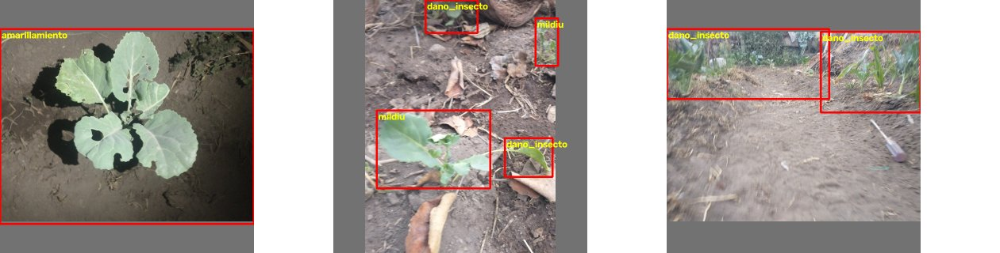
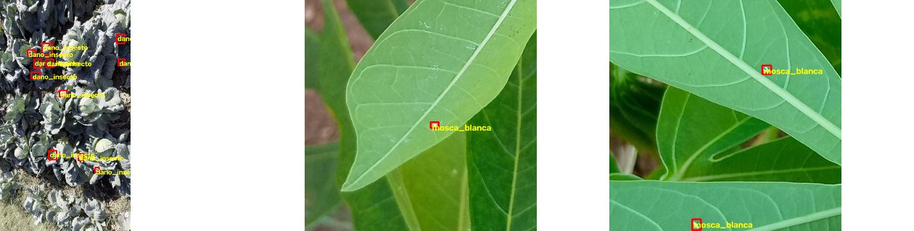

# Anexo C. Conjunto de datos de plagas y enfermedades

Este anexo describe los datos usados para entrenar PLAGASX v8, el modelo instalado en el robot.

## C.1 Clases

**Tabla C-1.** Número de cajas por clase.

| Clase | Entrenamiento | Validación | Prueba |
|---|---|---|---|
| `col_sana` | 144 | 41 | 15 |
| `col_amarillamiento` | 16 | 4 | 5 |
| `col_manchas_cafe` | 142 | 41 | 30 |
| `col_dano_insecto` | 6 555 | 884 | 718 |
| `col_mildiu_velloso` | 199 | 64 | 27 |
| `col_malformacion` | 143 | 39 | 18 |
| `col_pudricion` | 0 | 0 | 0 |
| `col_mosca_blanca` | 1 169 | 241 | 230 |
| `col_pulgon` | 1 176 | 78 | 67 |
| `col_oruga` | 742 | 76 | 72 |
| `col_pulguilla` | 357 | 12 | 15 |

Los datos están desbalanceados: casi todas las cajas son de daño de insecto y `col_amarillamiento` solo tiene 25. El modelo v8 no puede detectar `col_pudricion` porque esa clase no tuvo imágenes.

## C.2 Origen de las imágenes

**Tabla C-2.** Imágenes por origen.

| Origen | Contenido | Entren. | Valid. | Prueba | Calidad de las cajas |
|---|---|---|---|---|---|
| `mio` | Fotos propias de coles | 120 | 33 | 17 | Baja: automáticas, por color |
| `caj` | Daño y mosca blanca | 1 654 | 271 | 268 | Alta; mosca blanca casi siempre en otros cultivos |
| `ip` | IP102 | 1 819 | 127 | 124 | Alta; varias especies no son de coles |
| `ext` | Coliflor y col | 700 | 200 | 100 | Baja: cajas de imagen completa |
| `fondo` y `negint` | Imágenes sin plaga | 354 | 111 | 86 | No aplica |
| **Total** | | **4 647** | **742** | **595** | |

El modelo v8 obtuvo mAP50 de 0,843 y top-1 de 0,932 en esta prueba. Estos valores pueden ser optimistas, porque algunas fotos parecidas quedaron repartidas entre entrenamiento y prueba. Tampoco miden el desempeño con fotos nuevas del robot.

## C.3 Ejemplos

## C.4 PLAGASX v9

La versión 9 se lanzó el 8 de noviembre de 2026 para coles y coliflores. Usa un modelo mayor (yolo11m, 960 px) y añade la clase `col_trips`. Sus resultados no se incluyen porque seguía en entrenamiento al redactar este anexo.

Las imágenes de `col_trips` son de cereales y mango, **ninguna de coles**. Un buen resultado en esa clase no demuestra que detecte trips en coles.

## C.5 Pendiente

Falta etiquetar 150 fotos del robot sin ver la salida del modelo (prueba P6). Sin ese dato no se puede afirmar cuántas plagas reales detecta el modelo.
