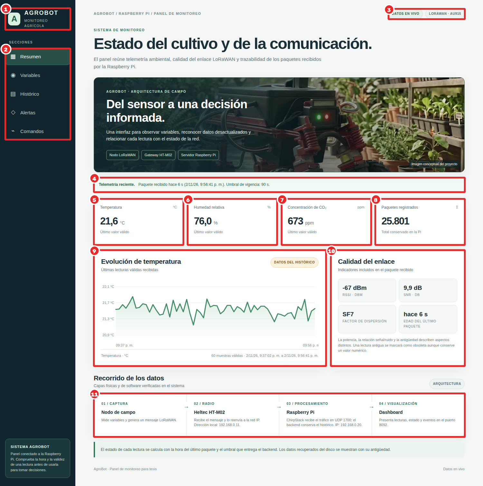
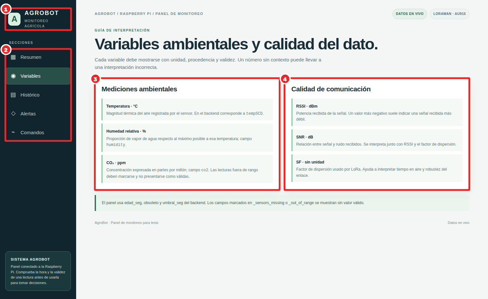
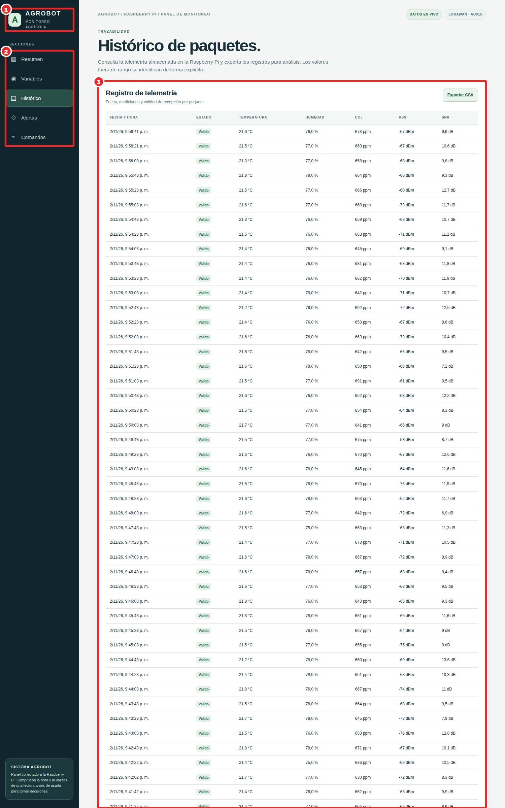
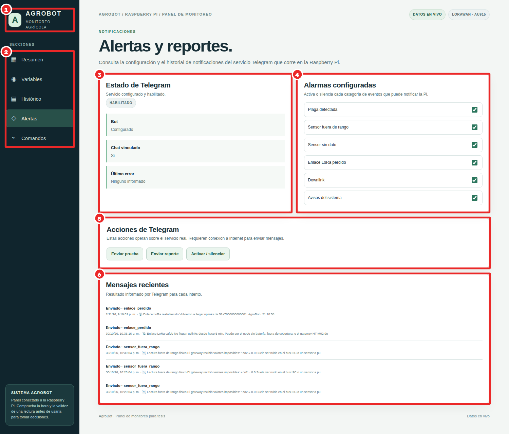
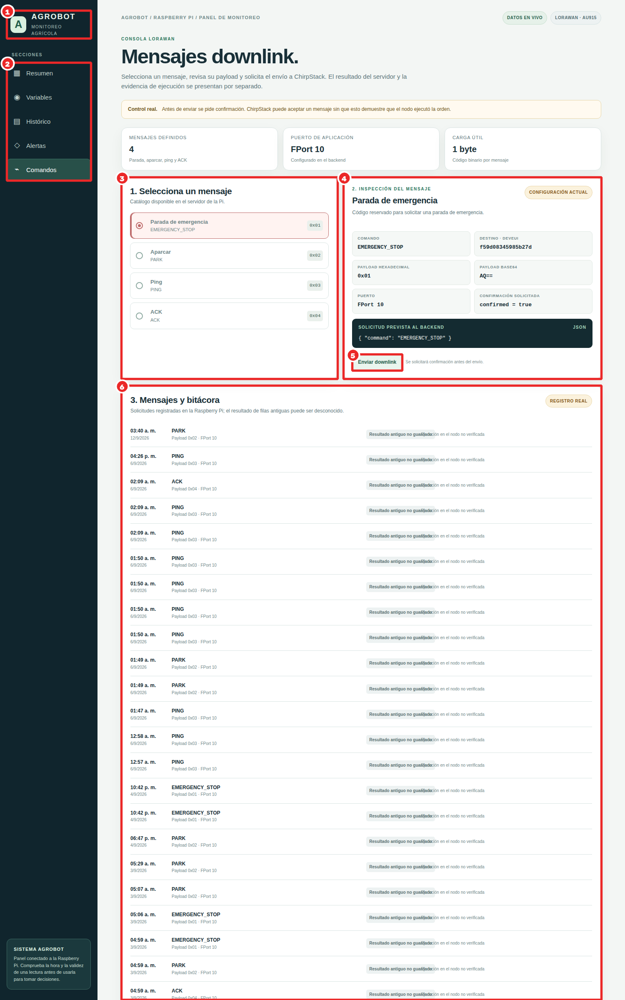

# Dashboard de la Raspberry Pi (gateway LoRaWAN)

Capturado de `http://100.121.219.100:8092/` el 2026-11-02 21:56. Código: copia de lo servido por la Pi en `rpi/dashboard/vivo_20261102/` (la versión `rpi/dashboard/index.html` del repositorio es anterior) y `rpi/server/gateway_server.py`.

## Resumen

Vista principal: lo que el nodo ambiental Heltec ESP32 LoRa V3 envía por LoRaWAN (gateway HT-M02 → ChirpStack → MQTT → servidor de la Pi), con la vigencia de cada dato.

| # | Parte | Qué hace | Interacción técnica | Módulo |
|---|---|---|---|---|
| 1 | Identidad | Nombre del sistema: AgroBot, monitoreo agrícola. | — | — |
| 2 | Secciones | Resumen, Variables, Histórico, Alertas y Comandos. | Local (JavaScript) | — |
| 3 | Estado de la conexión y plan regional | «Datos en vivo» mientras el WebSocket está abierto; plan de frecuencias del enlace (LoRaWAN · AU915: canales 0–7, 915,2–916,6 MHz, banda de uso libre según el PNF de ARCOTEL). | WebSocket `/ws` | `gateway_server.py` |
| 4 | Aviso de vigencia | Compara la hora del último paquete con el umbral de vigencia (90 s). Si se supera, marca el dato como OBSOLETO: se muestra como histórico, no como lectura en vivo. | WebSocket `/ws`, GET `/api/estado` | `gateway_server.py` |
| 5 | Temperatura | Último valor del SCD40 con su estado (válido, cero sospechoso, obsoleto). | WebSocket `/ws` | `decoder.py, schema.py` |
| 6 | Humedad relativa | Igual que la temperatura. | WebSocket `/ws` | `decoder.py` |
| 7 | CO₂ | Concentración en ppm; «dato ausente o fuera de rango» si el valor es imposible. | WebSocket `/ws` | `decoder.py` |
| 8 | Paquetes registrados | Total de uplinks conservados en la base SQLite de la Pi. | GET `/api/estado` | `gateway_server.py (SQLite)` |
| 9 | Evolución de temperatura | Serie de las últimas lecturas válidas; avisa si la serie es constante (sensor sospechoso). | GET `/api/history?limit=60` | `gateway_server.py` |
| 10 | Calidad del enlace | RSSI (potencia recibida), SNR (relación señal/ruido), SF (factor de dispersión) y edad del último paquete. | WebSocket `/ws` (rxInfo de ChirpStack) | `gateway_server.py` |
| 11 | Recorrido de los datos | Las 4 capas: captura (nodo), radio (HT-M02, 192.168.0.11), procesamiento (ChirpStack en la Pi, UDP 1700) y visualización (puerto 8092). | — | — |

## Variables

Detalle de cada variable ambiental y de la calidad de la comunicación, con su unidad, rango válido y estado.

| # | Parte | Qué hace | Interacción técnica | Módulo |
|---|---|---|---|---|
| 1 | Identidad | Nombre del sistema: AgroBot, monitoreo agrícola. | — | — |
| 2 | Secciones | Resumen, Variables, Histórico, Alertas y Comandos. | Local (JavaScript) | — |
| 3 | Mediciones ambientales | Temperatura, humedad y CO₂ con su último valor válido y su vigencia. | WebSocket `/ws` | `decoder.py` |
| 4 | Calidad de comunicación | RSSI, SNR, SF y frecuencia del último paquete. | WebSocket `/ws` | `gateway_server.py` |

## Histórico

Trazabilidad: cada paquete recibido con su hora, variables y metadatos de radio.

| # | Parte | Qué hace | Interacción técnica | Módulo |
|---|---|---|---|---|
| 1 | Identidad | Nombre del sistema: AgroBot, monitoreo agrícola. | — | — |
| 2 | Secciones | Resumen, Variables, Histórico, Alertas y Comandos. | Local (JavaScript) | — |
| 3 | Registro de telemetría | Tabla de los últimos paquetes guardados en la Pi. | GET `/api/history?limit=60` | `gateway_server.py (SQLite)` |

## Alertas

La Pi es la única pieza con salida a internet: avisa al operador por Telegram. La Jetson le envía las alertas del robot por `POST /api/alert`.

| # | Parte | Qué hace | Interacción técnica | Módulo |
|---|---|---|---|---|
| 1 | Identidad | Nombre del sistema: AgroBot, monitoreo agrícola. | — | — |
| 2 | Secciones | Resumen, Variables, Histórico, Alertas y Comandos. | Local (JavaScript) | — |
| 3 | Estado de Telegram | Si el bot está configurado y activo, y el chat de destino. | GET `/api/telegram` | `telegram_notifier.py` |
| 4 | Alarmas configuradas | Plaga detectada por la Jetson, sensor fuera de rango, sensor caído, enlace perdido (5 min sin paquetes), downlink de emergencia y avisos del sistema; una alarma del mismo tipo cada 5 min como máximo. | GET/POST `/api/telegram` | `telegram_notifier.py` |
| 5 | Acciones | Enviar prueba, enviar reporte de lecturas y activar o silenciar las alarmas. | POST `/api/telegram/test`, `/api/telegram/report`, `/api/telegram` | `telegram_notifier.py` |
| 6 | Mensajes recientes | Bitácora de lo enviado y su resultado. | GET `/api/telegram` | `telegram_notifier.py` |

## Comandos (downlink)

Mensajes de la Pi hacia el nodo por la API REST de ChirpStack. El nodo es clase A: solo escucha justo después de transmitir, así que un comando tarda hasta ~30 s. Es un canal de respaldo, no un mando en tiempo real.

| # | Parte | Qué hace | Interacción técnica | Módulo |
|---|---|---|---|---|
| 1 | Identidad | Nombre del sistema: AgroBot, monitoreo agrícola. | — | — |
| 2 | Secciones | Resumen, Variables, Histórico, Alertas y Comandos. | Local (JavaScript) | — |
| 3 | 1. Selección | Parada de emergencia, aparcar (PARK), ping y ACK. | Local | — |
| 4 | 2. Inspección del mensaje | Muestra qué bytes se enviarán y qué significa el comando antes de mandarlo. | Local | — |
| 5 | Enviar downlink | Pide confirmación y encola el comando en ChirpStack. | POST `/api/downlink` | `gateway_server.py → API REST de ChirpStack` |
| 6 | 3. Mensajes y bitácora | Comandos enviados con su estado; la ejecución en el nodo se marca «no verificada» hasta tener confirmación. | GET `/api/downlinks?limit=30` | `gateway_server.py` |

## Cómo funcionan las alertas por Telegram

Fuente: `rpi/server/telegram_notifier.py` y `rpi/server/gateway_server.py`.

**Por qué en la Pi.** La Raspberry Pi es la única pieza del sistema con salida a internet. La Jetson, los ESP32 y el dashboard local viven en la red
aislada del punto de acceso. Cuando la Jetson detecta algo (por ejemplo una plaga con YOLO), lo envía por la LAN a la Pi (`POST /api/alert`,
`AGROBOT_GATEWAY_URL` en `jetson_server.py`), y la Pi lo publica en Telegram.

**Cómo envía.** Llama a la API oficial de bots (`https://api.telegram.org/bot<token>/sendMessage`) por HTTPS, con formato HTML.
Para recibir comandos desde el chat (por ejemplo `/reporte`) usa *long polling* (`getUpdates`) y no *webhook*: así no necesita IP pública ni
certificado TLS, algo habitual en campo detrás de un router 4G. El token puede venir de la variable `TELEGRAM_BOT_TOKEN` para no dejarlo en disco.

**Qué envía.**

| Tipo | Cuándo | Icono |
|---|---|---|
| `plaga` | La Jetson empuja una detección (clase, confianza y foto si la hay) | 🐛 |
| `sensor_fuera_rango` | Un paquete trae un valor físicamente imposible (p. ej. CO₂ = 0) | 📉 |
| `sensor_caido` | Un sensor no inicializó y llega 0,0 en sus campos | 🔌 |
| `enlace_perdido` | Más de 5 min sin uplinks (y aviso de «restablecido» cuando vuelven) | 📡 |
| `downlink` | Se encoló un comando de emergencia en ChirpStack | 🛑 |
| `sistema` | Avisos genéricos del backend | ⚙️ |

**Antirrebote.** Cada tipo tiene su interruptor y como máximo una alarma cada 5 min (`cooldown_s` = 300). Sin esto, un sensor I2C mudo mandaría un
mensaje por cada uplink y el operador acabaría silenciando el bot.

**Reporte.** A pedido (botón del dashboard o `/reporte` en el chat) o automático cada N minutos: promedios, mínimos y máximos, calidad del enlace y
cuántos paquetes llegaron marcados como sospechosos.

**Robustez.** Un fallo de red no tumba el gateway: el error se registra («Último error» en la pestaña Alertas) y se borra en la siguiente llamada correcta.
