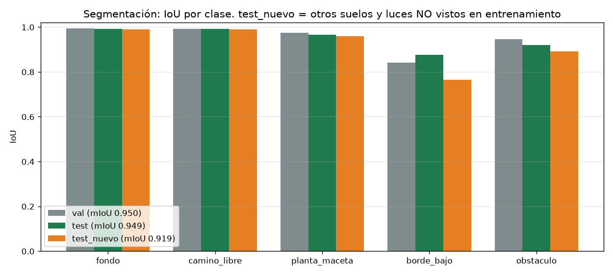
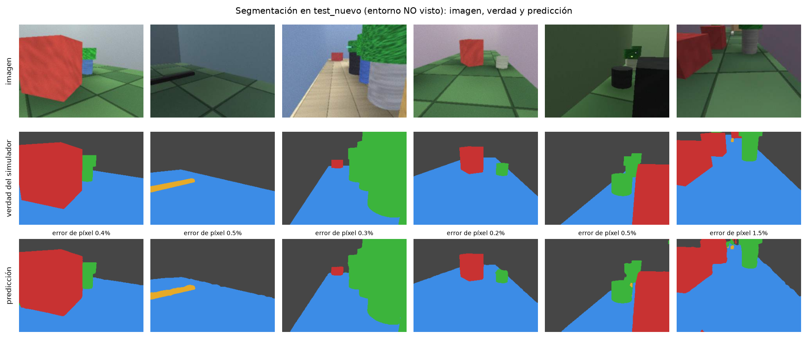
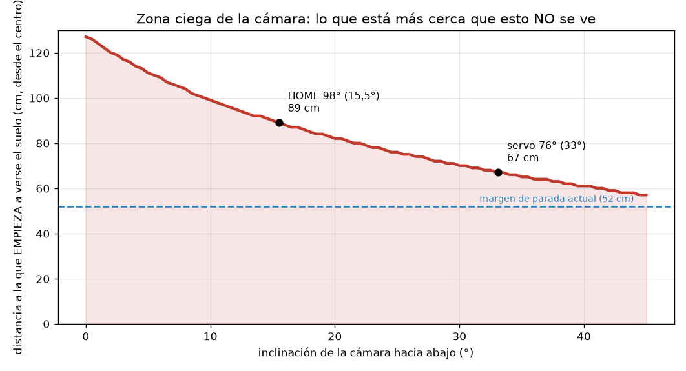
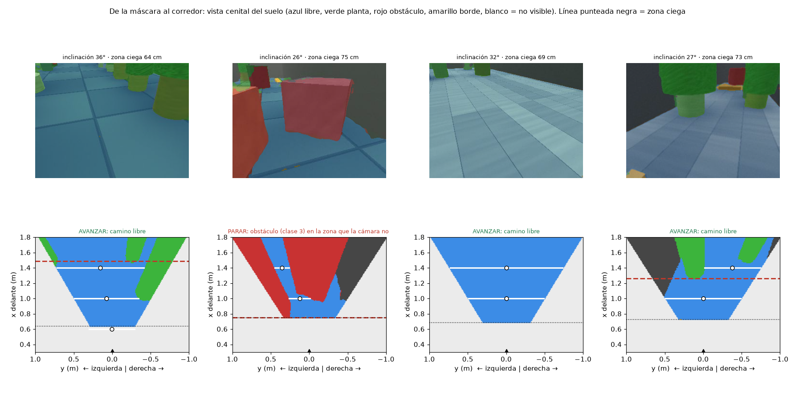
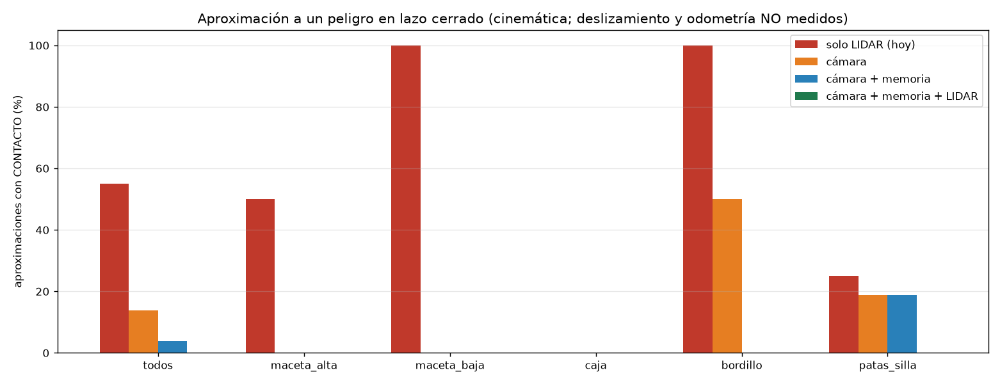
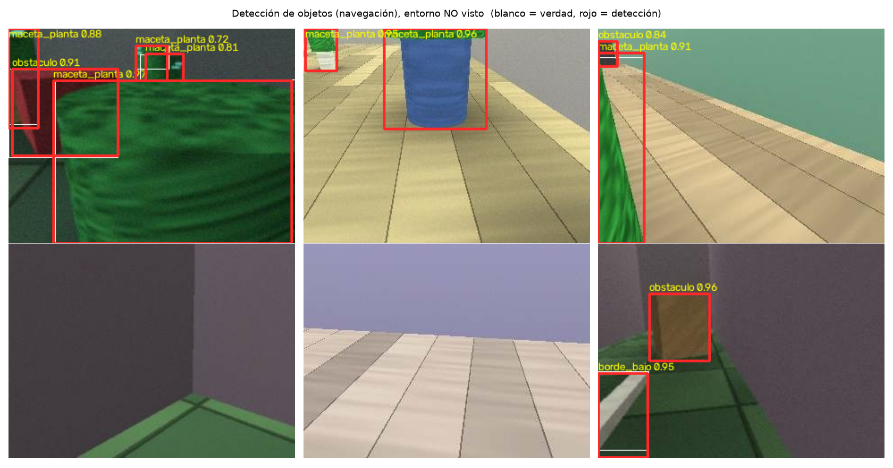

# Percepción de navegación con cámara sintética — 2026-10-15

> **Todo esto es simulación.** Ningún modelo se ha evaluado sobre fotos reales de suelo o pasillo, y **nada se ha desplegado al robot**. Las cifras miden si la red aprende la geometría y el contraste de un mundo sintético, no que funcione en tu huerto ni en una sala real.

## 1. Qué se construyó

| pieza | fichero (`simulador_pasivo/percepcion_sintetica/`) |
|---|---|
| Render por trazado de rayos con verdad por píxel (suelo, paredes, macetas con planta, cajas, bordillos de 4-8 cm, patas de silla) | `render.py` |
| Escenas y poses; dataset **por sesión** (train 160 · val 30 · test 40 · test_nuevo 24 con otros suelos y luces) | `escena.py`, `generar_dataset.py` |
| Segmentación UNet (5 clases, RGB, checkpoint con metadatos) | `entrenar_seg.py` |
| Corredor libre, decisión avanzar/reducir/parar, memoria de obstáculos | `corredor.py` |
| Evaluación contra la geometría real y aproximación en lazo cerrado | `evaluar_corredor.py`, `aproximacion.py` |
| Detector de objetos YOLO11n | `exportar_yolo.py`, `entrenar_yolo.py` |
| Entrenamiento con fotos REALES etiquetadas de plagas (listo, sin datos aún) | `entrenar_plagas_real.py` |

La geometría de cámara es **idéntica** a `sendero.Cenital` (test: 0,00 px de diferencia), así que un píxel segmentado como suelo libre se proyecta donde lo haría en el robot.

## 2. Segmentación (UNet mobilenetv3, mejor época 17 de 18)

| IoU | val | test | test_nuevo (otro suelo/luz) |
|---|---|---|---|
| fondo | 0.994 | 0.992 | 0.989 |
| camino_libre | 0.993 | 0.992 | 0.990 |
| planta_maceta | 0.975 | 0.965 | 0.959 |
| borde_bajo | 0.842 | 0.876 | 0.765 |
| obstaculo | 0.947 | 0.921 | 0.891 |
| **mIoU** | **0.950** | **0.949** | **0.919** |

Con otro suelo y otra luz el **borde bajo** (el que el LIDAR no ve) cae de 0.88 a 0.76: es la clase frágil.

## 3. Zona ciega de la cámara (límite físico)

La cámara **no ve suelo a menos de ~89 cm** del centro del robot con la inclinación por defecto (15,5°), ~67 cm con el servo a 76° (33°) y ~111 cm a 5°. Un objeto con la base ahí no se ve, y la parte alta que sí se ve proyecta **más lejos** de lo que está (error en el sentido peligroso). Además el campo de visión limita el ancho visible a ~±0,47 m a 1 m, así que el ancho de un pasillo es una **cota inferior**.

## 4. Corredor y decisión, contra la geometría real de la escena

Peligro = obstáculo en el pasillo barrido entre 0,5 y 0,85 m. Por debajo de 0,5 m el robot ya está pegado y ningún sensor de visión ayuda.

| | test | test_nuevo |
|---|---|---|
| fotogramas | 960 | 576 |
| peligros | 224 | 124 |
| **peligros VISIBLES no frenados** | 0 de 34 | 3 de 16 |
| peligros en zona ciega no frenados | 34 de 190 (17.9%) | 12 de 108 (11.1%) |
| paradas inútiles (camino libre) | 6.4% | 15.1% |
| error de distancia al obstáculo (mediana) | 12.9 cm | 12.1 cm |
| error del centro del corredor (donde se ven las 2 paredes) | 0.7 cm | 0.9 cm |
| latencia por fotograma (modelo + corredor) | 19.3 ms | 15.7 ms |

**Robustez** (subconjunto de 93 peligros del split test: no es comparable punto a punto con la base de 224; entre paréntesis, no frenados): base 34/224 (15.2%); oscuridad 17/93 (18.3%); brillo 17/93 (18.3%); ruido 17/93 (18.3%); desenfoque 17/93 (18.3%); oclusión 13/93 (14.0%). Con **fotograma negro o saturado el 100% se para** (falla seguro). Un error de inclinación de −3° da 25/93 (26.9%) y de +3° 12/93 (12.9%): **la calibración del servo importa**.

**Fotos reales del robot** (1-oct, cámara mirando a una pared, sin suelo): decisión «parar» en 59 de 59. Son 59 fotos de una sola escena: sirven como prueba de fallo seguro, **no** para medir segmentación de suelo.

## 5. Aproximación a un peligro en lazo cerrado

Movimiento **cinemático** (no usa la dinámica de ruedas, que no es fiable). El deslizamiento al soltar (0,15 y 0,40 m) y la odometría (perfecta aquí) **no están medidos**. 80 aproximaciones por sistema (16 por peligro: intervalos de confianza anchos).

| contactos (%) | solo LIDAR (hoy) | cámara | cámara + memoria | cámara + memoria + LIDAR |
|---|---|---|---|---|
| todos | 55.0 | 13.8 | 3.8 | 0.0 |
| maceta_alta | 50.0 | 0.0 | 0.0 | 0.0 |
| maceta_baja | 100.0 | 0.0 | 0.0 | 0.0 |
| caja | 0.0 | 0.0 | 0.0 | 0.0 |
| bordillo | 100.0 | 50.0 | 0.0 | 0.0 |
| patas_silla | 25.0 | 18.8 | 18.8 | 0.0 |

La memoria del obstáculo (resta el avance por odometría) es lo que permite frenar ante algo que ya entró en la zona ciega. **Depende de que la odometría de avance sea fiable**, y la del robot real no lo fue en la auditoría. Lo que queda sin resolver son las patas de silla (muy finas).

## 6. Detección de objetos (YOLO11n, 320 px, 4 ms/imagen)

| mAP50 | val | test | test_nuevo |
|---|---|---|---|
| maceta_planta | 0.939 | 0.930 | 0.890 |
| obstaculo | 0.930 | 0.900 | 0.926 |
| borde_bajo | 0.845 | 0.924 | 0.855 |
| **todas** | **0.904** | **0.918** | **0.891** |

## 7. Plagas y enfermedades (col, coliflor, acelga): estado real

- **No hay ningún modelo entrenado que las reconozca.** Se probaron los dos detectores que ya tiene el robot sobre 4 fotos reales: `ip102_pest_yolo11s.pt` (102 clases de arroz y trigo, **sin mosca blanca ni minador**) da 0 detecciones en 3 de 4 fotos; `agrobot_plagas_det.pt` (6 clases) confunde el racimo de trips con «gusano cortador».
- Se probó también un análisis clásico de la hoja (insectos pequeños, agujeros, lesiones). **Falló** (291-791 «insectos» por foto por reflejos y textura; no detectó el agujero grande de la acelga) y se descartó (`jetson/backend/salud_hoja/DESCARTADO_salud_hoja.py`).
- Con 4 fotos sin etiquetar **no se puede entrenar un modelo fiable**. Los «insectos» del dataset sintético eran sprites sencillos y se abandonaron.
- **Tizón** es una enfermedad (lesiones en la hoja), no un insecto: necesita otra clase y otras fotos. No hay ninguna en la Jetson.

Lo que sí queda listo: `entrenar_plagas_real.py`, que parte cada foto en mosaicos (la mosca blanca mide unos píxeles), separa **por planta** y nunca activa el modelo solo. Necesita fotos etiquetadas de **al menos 3 plantas**.

## 8. Qué NO está demostrado

- Nada con fotos reales de suelo o pasillo. El test «dominio nuevo» solo cambia suelos y luces dentro del mismo simulador.
- El deslizamiento del robot al soltar el mando y la odometría de avance (de ambos depende que se frene a tiempo).
- La calibración de la inclinación del servo (`calibracion_camara.VERIFICADO = False`).
- Cualquier detección de plagas o enfermedades reales.

## 9. Reversión
No se ha tocado el backend ni se ha cambiado `ai.active_model`. Los modelos están en `percepcion_sintetica/modelos/`. Para usar uno en el robot haría falta copiarlo a `jetson/backend/models/` y elegirlo en el dashboard; volver atrás es elegir el anterior.
