# AgroBot · Reporte de simulación, entrenamiento y mejoras — 2026-10-23

Generado 2026-10-23 11:30 · datos reales de las pruebas de hoy (grabaciones de campo + SLAM) y simulación calibrada con ellos.

## 1. Qué pasó en las pruebas reales de hoy

| sesión | duración (s) | recorrido (m) | toques probables | toques/min | % del tiempo a <5 cm | % a <12 cm |
|---|---|---|---|---|---|---|
| 012852_2d8e48 | 267 | 36.0 | 15 | 3.37 | 52.6 | 66.2 |
| 044532_febee4 | 77 | 12.8 | 6 | 4.7 | 8.4 | 62.2 |
| 051014_6ba57f | 233 | 30.9 | 4 | 1.03 | 10.0 | 42.2 |
| 054140_db26bf | 959 | 111.5 | 16 | 1.0 | 19.4 | 33.5 |

«Toque probable» = el cuerpo llega a ≤ 2 cm de algo según el LIDAR (episodios separados > 1,5 s). Desde la primera prueba (01:28) a la última (05:41) la tasa baja de ~3,4-4,7 a ~1,0 toques/min con el freno activo, el 100 % continuo y la anticolisión trasera.

| sesión | misiones | plantas detectadas | inspeccionadas | inspecciones fallidas | motivos |
|---|---|---|---|---|---|
| 012852_2d8e48 | 0 | 0 | 0 | 0 | {} |
| 044532_febee4 | 1 | 0 | 0 | 0 | {} |
| 051014_6ba57f | 4 | 9 | 4 | 0 | {} |
| 054140_db26bf | 8 | 14 | 7 | 6 | {"orden manual": 4, "no logré centrar el objetivo": 2} |

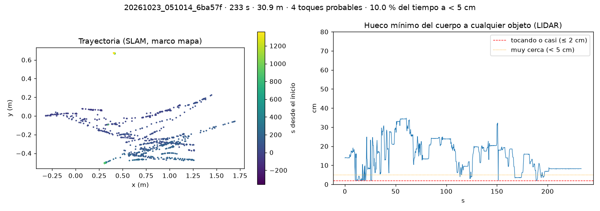
*Trayectoria y hueco libre — 20261023_051014_6ba5*

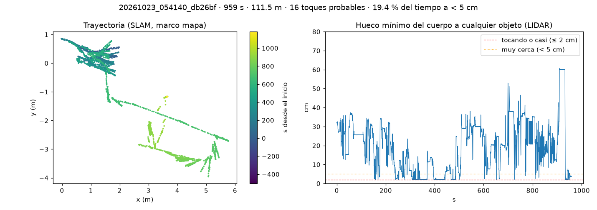
*Trayectoria y hueco libre — 20261023_054140_db26*

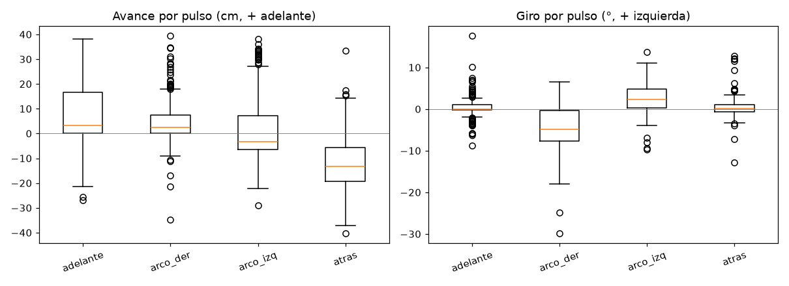
*Desplazamiento y giro por tipo de pulso (todas las sesiones). Izquierda gira menos y retrocede más que derecha (antes de compensar).*

## 2. Simulador calibrado con los pulsos reales

| pulso | real: giro° / avance cm | simulador calibrado: giro° / avance cm |
|---|---|---|
| adelante | +0.4 / +9.1 | +0.0 / +9.0 |
| atras | +0.3 / -14.2 | +0.1 / -13.8 |
| derecha | -4.0 / +5.3 | -3.0 / +2.8 |
| izquierda | +2.3 / +0.0 | +3.1 / +2.8 |

Sin calibrar el simulador recorría 18 cm hacia delante por pulso (real: 9) y casi no giraba en los arcos. Parámetros ajustados: masa=12.65, bias=3.48, mu=0.80, drag=0.16, efic_fwd=0.62, efic_rev=0.91, lado_der=1.01, lado_izq=1.09, dead=0.00, lateral=18.52, pfric=0.05.

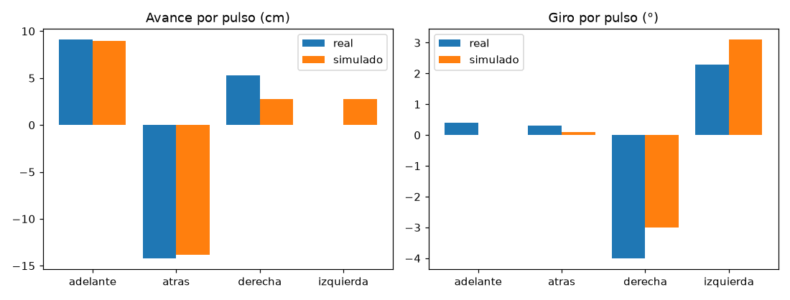
*Real vs simulador calibrado*

## 3. Zoom automático y detección de plagas al acercarse

La cámara es de foco fijo (sin control de enfoque): «enfocar» = llevar la planta al centro (la visión activa gira el robot y mueve el tilt), acercarla con zoom digital (recorte del sensor a 1280×720, hasta 3×) y quedarse con el cuadro más nítido. Validación: hojas reales de col (sana, mildiu, mancha de alternaria) pegadas a escala sobre fondos reales del robot; el clasificador del robot (PLAGASX) con y sin zoom.

| tamaño de la planta (fracción del ancho) | sin_zoom | zoom_0.55 | zoom_0.72 | zoom_0.8 | zoom_0.85 | zoom_0.8+recorte |
|---|---|---|---|---|---|---|
| 0.1 | 1 % | 17 % (z=2.88) | 23 % (z=3.0) | 23 % (z=3.0) | 23 % (z=3.0) | 30 % (z=3.0) |
| 0.15 | 1 % | 24 % (z=2.21) | 26 % (z=2.76) | 31 % (z=2.88) | 31 % (z=2.89) | 32 % (z=2.88) |
| 0.22 | 6 % | 18 % (z=1.39) | 29 % (z=1.81) | 31 % (z=2.19) | 39 % (z=2.3) | 34 % (z=2.19) |
| 0.32 | 11 % | 17 % (z=1.07) | 28 % (z=1.36) | 28 % (z=1.39) | 31 % (z=1.45) | 36 % (z=1.39) |
| 0.45 | 23 % | 24 % (z=1.0) | 26 % (z=1.06) | 28 % (z=1.07) | 29 % (z=1.07) | 34 % (z=1.07) |
| 0.65 | 27 % | 24 % (z=1.0) | 24 % (z=1.0) | 24 % (z=1.0) | 26 % (z=1.0) | 31 % (z=1.0) |
| 1.0 | 34 % | 30 % (z=1.0) | 30 % (z=1.0) | 30 % (z=1.0) | 30 % (z=1.0) | 33 % (z=1.0) |

Exactitud del clasificador (3 clases, 110 imágenes por celda). El zoom ayuda sobre todo cuando la planta ocupa menos del 35 % de la imagen; clasificar además el recorte de la planta gana en todas las escalas.

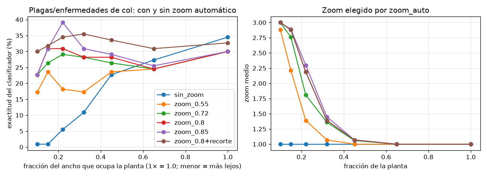
*Exactitud vs distancia con y sin zoom automático*

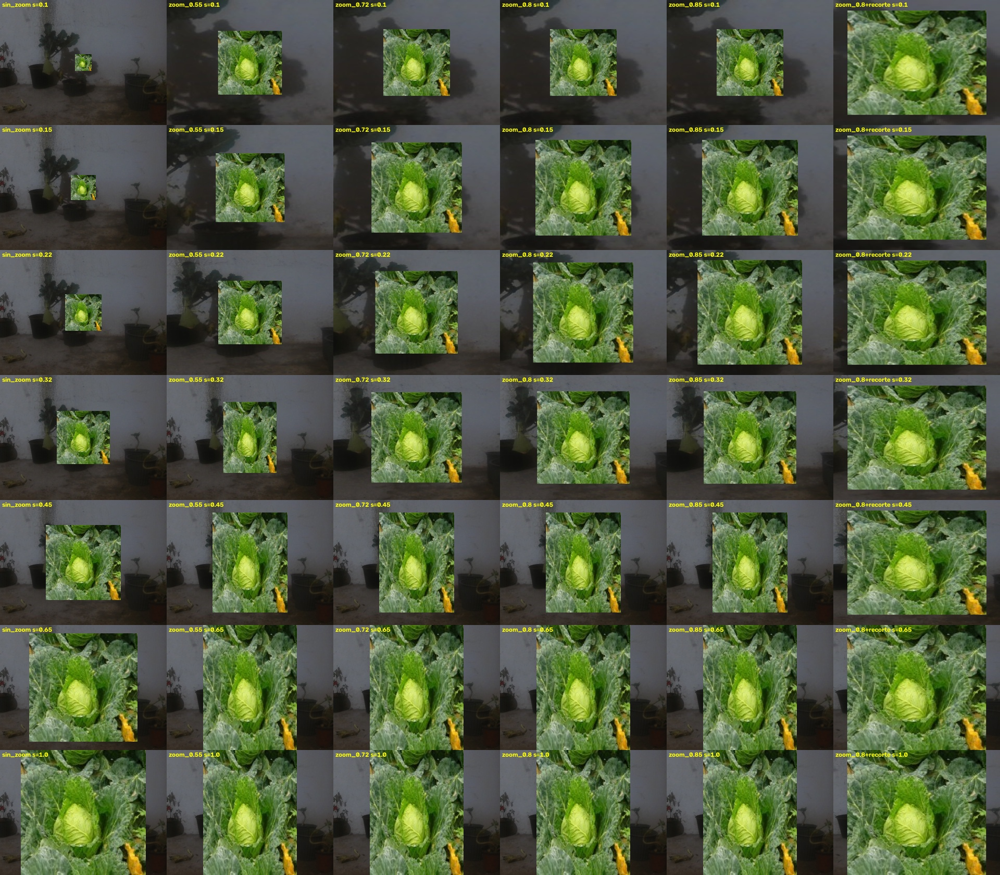

## 3b. Servo de la cámara hacia abajo con macetas bajas

Sobre las 1578 fotos reales de la prueba de las 05:41, el modelo de macetas ve alguna en 592; en 233 (39.4 %) la maceta está cortada por el borde inferior o con el centro en el 38 % de abajo con el criterio inicial: son las que el robot pierde de vista justo antes de tocarlas. El criterio final es más estricto (cortada ≥ 96 % o centro ≥ 70 %, 2 decisiones seguidas, tope 66°): el servo baja el 27,5 % del tiempo, unas 6 veces por minuto, y vuelve al reposo (98°) a los 4 s sin macetas. Solo actúa en autonomía y no con el operador al mando.

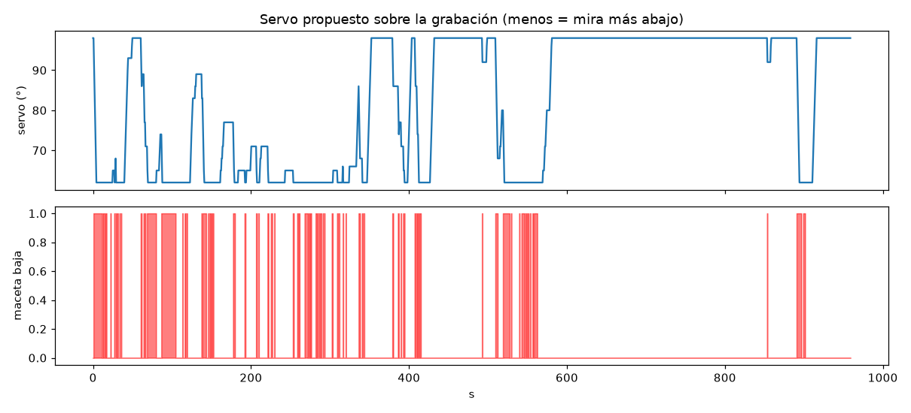
*Ángulo de servo propuesto sobre la grabación y cuadros con maceta baja (criterio inicial)*

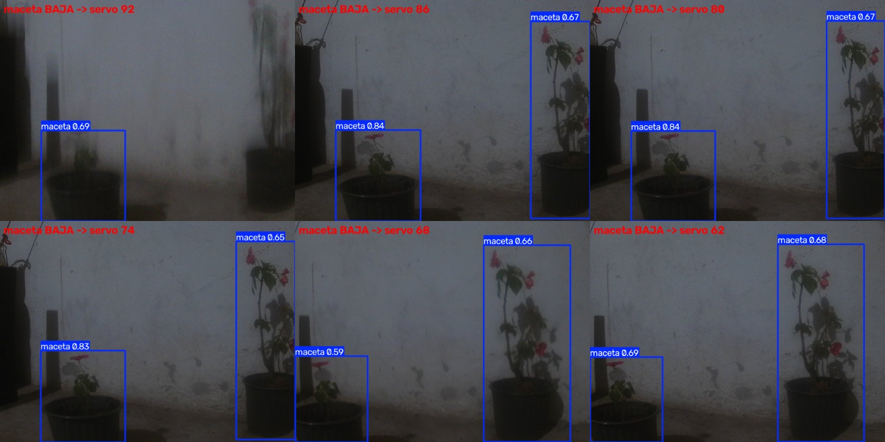

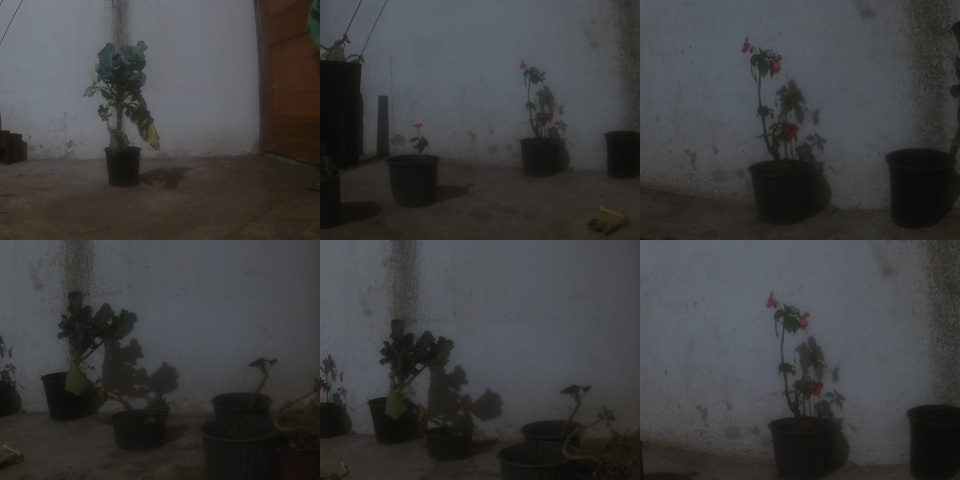

## 4. Entrenamiento intensivo (simulación calibrada, interior 70 % · exterior 30 %)

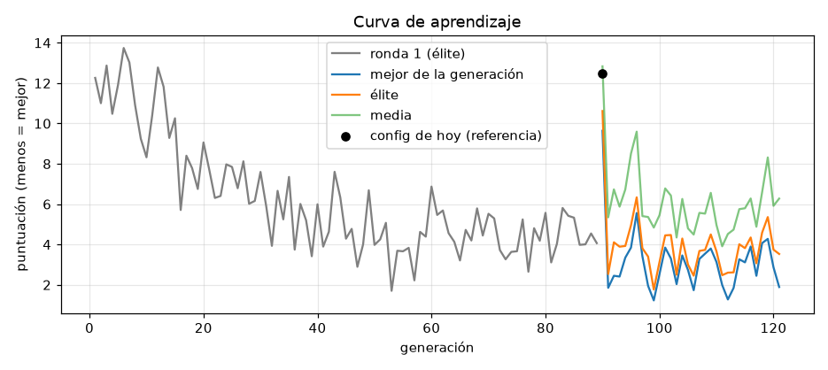
*32 generaciones en total, cada una con semillas nuevas (24 candidatos)*

| config | éxito % (todo) | contactos/ep | puntos | éxito % interior | contactos int. | éxito % exterior | contactos ext. |
|---|---|---|---|---|---|---|---|
| top1 | 74.4 | 0.36 | 4.592 | 79.2 | 0.27 | 58.3 | 0.67 |
| top2 | 73.7 | 0.53 | 5.377 | 75.8 | 0.57 | 66.7 | 0.36 |
| top3 | 78.8 | 0.22 | 3.717 | 81.7 | 0.2 | 69.4 | 0.28 |
| top4 | 80.1 | 0.3 | 3.693 | 80.0 | 0.32 | 80.6 | 0.25 |
| top5 | 80.1 | 0.26 | 3.585 | 81.7 | 0.24 | 75.0 | 0.33 |
| top6 | 72.4 | 0.44 | 5.191 | 77.5 | 0.38 | 55.6 | 0.61 |
| media_final | 73.1 | 0.46 | 5.325 | 82.5 | 0.25 | 41.7 | 1.17 |
| HOY | 53.2 | 0.89 | 9.26 | 65.0 | 0.58 | 13.9 | 1.92 |
| AYER | 53.8 | 0.79 | 8.643 | 62.5 | 0.64 | 25.0 | 1.28 |
| ronda1 | 72.4 | 0.43 | 5.191 | 77.5 | 0.42 | 55.6 | 0.47 |

Validación en semillas nunca vistas (120 episodios de interior, 36 de exterior por configuración). HOY = lo flasheado esta mañana; AYER = sin freno activo ni compensación; ronda1 = el mejor de la primera ronda.

| parámetro | hoy | mejor (top5) |
|---|---|---|
| escala_int | 0.13 | 0.334 |
| escala_ext | 0.5 | 0.474 |
| suavidad_duty | 0.35 | 0.442 |
| suavidad_periodo_s | 0.2 | 0.423 |
| sendero_tol_cm | 10 | 15.0 |
| avance_libre_int | 40 | 49.617 |
| avance_libre_ext | 100 | 130.267 |
| cono_int | 45 | 51.404 |
| cono_ext | 20 | 45.0 |
| fu_adel | 100 | 87.676 |
| fu_pivote | 100 | 95.663 |
| fu_tras | 150 | 100.0 |
| fu_dif_del | 100 | 75.154 |
| fu_acel | 600 | 421.047 |
| fu_frena | 1000 | 878.787 |
| fu_freno_ms | 80 | 120.067 |
| fu_comp_neg | 25 | 45.241 |
| fu_comp_pos | 0 | 37.934 |

| escenario | mejor: éxito % | contactos/ep | puntos | hoy: éxito % | hoy: contactos/ep |
|---|---|---|---|---|---|
| interior/sala_vacia | 100.0 | 0.0 | 0.31 | 91.7 | 0.12 |
| interior/pasillo_macetas | 91.7 | 0.12 | 1.66 | 75.0 | 0.5 |
| interior/eslalon_macetas | 37.5 | 0.83 | 9.93 | 37.5 | 0.83 |
| interior/curva_pasillo | 100.0 | 0.0 | 0.6 | 75.0 | 0.46 |
| interior/callejon_1m | 79.2 | 0.25 | 3.48 | 45.8 | 1.0 |
| exterior/huerta_hileras | 100.0 | 0.0 | 0.58 | 25.0 | 1.92 |
| exterior/campo_rocas | 41.7 | 0.75 | 10.26 | 16.7 | 0.33 |
| exterior/camino_plantas | 83.3 | 0.25 | 3.79 | 0.0 | 3.5 |

| config | éxito % (estrés) | contactos/ep | puntos |
|---|---|---|---|
| mejor | 74.4 | 0.37 | 4.613 |
| HOY | 61.5 | 0.69 | 7.501 |
| AYER | 56.4 | 0.95 | 9.095 |

Estrés: robot más flojo (más masa, más rozamiento, menos agarre).

### Confirmación sin sesgo (otro juego de semillas)

| entorno | config | episodios | éxito % | contactos/ep | % sin contacto | puntos |
|---|---|---|---|---|---|---|
| hardware calibrado | mejor | 156 | 78.2 | 0.29 | 80.8 | 3.943 |
| hardware calibrado | HOY | 156 | 56.4 | 0.78 | 59.0 | 8.355 |
| hardware calibrado | AYER | 156 | 62.2 | 0.6 | 62.8 | 7.009 |
| hardware más flojo | mejor | 78 | 74.4 | 0.35 | 79.5 | 4.655 |
| hardware más flojo | HOY | 78 | 43.6 | 1.1 | 47.4 | 10.966 |
| hardware más flojo | AYER | 78 | 41.0 | 1.22 | 42.3 | 11.815 |

El candidato salió de varios validados (su validación es algo optimista): esta tabla usa semillas que no vio nadie. La mejora se confirma.

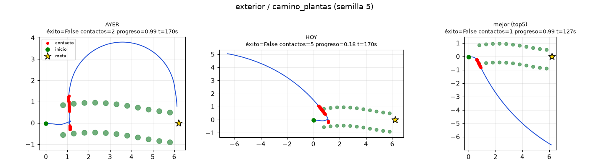
*Episodio simulado: exterior_camino_plantas*

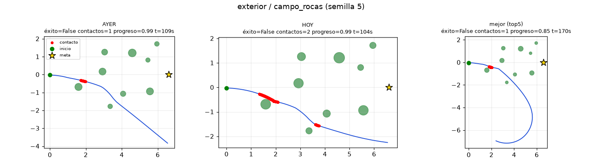
*Episodio simulado: exterior_campo_rocas*

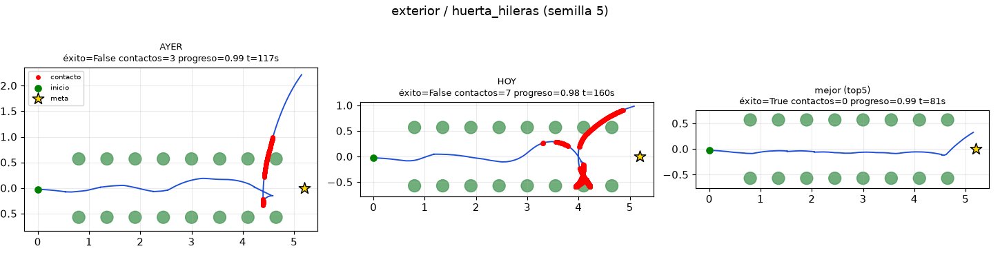
*Episodio simulado: exterior_huerta_hileras*

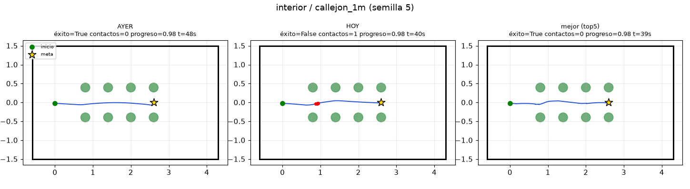
*Episodio simulado: interior_callejon_1m*

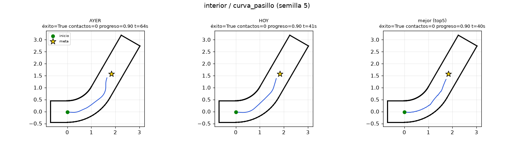
*Episodio simulado: interior_curva_pasillo*

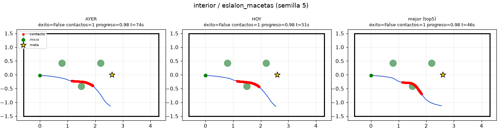
*Episodio simulado: interior_eslalon_macetas*

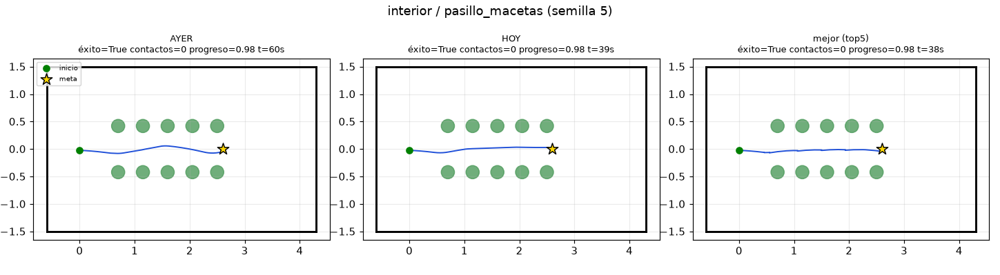
*Episodio simulado: interior_pasillo_macetas*

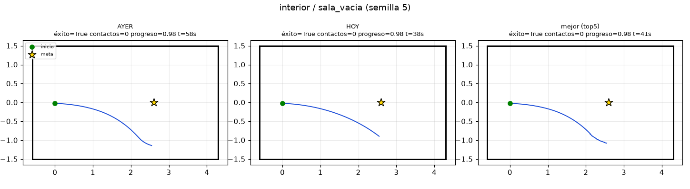
*Episodio simulado: interior_sala_vacia*

## 4b. SLAM: corrector de odometría reentrenado con los datos de hoy

| sesión real | variante | ATE (m) | RPE 1 m (m) | RPE 1 m (°) | error final (m) |
|---|---|---|---|---|---|
| retenida_2 | base | 0.111 | 0.086 | 2.34 | 0.226 |
| retenida_2 | existente | 1.957 | 1.951 | 89.75 | 3.309 |
| retenida_2 | sim+real | 0.143 | 0.074 | 2.44 | 0.371 |
| entrenamiento_0 | base | 0.438 | 0.447 | 5.46 | 0.681 |
| entrenamiento_0 | existente | 2.488 | 2.183 | 98.81 | 4.599 |
| entrenamiento_0 | sim+real | 0.523 | 0.439 | 9.81 | 0.915 |
| entrenamiento_3 | base | 0.169 | 0.086 | 2.14 | 0.156 |
| entrenamiento_3 | existente | 1.686 | 2.135 | 114.32 | 1.763 |
| entrenamiento_3 | sim+real | 0.259 | 0.093 | 3.7 | 0.626 |
| entrenamiento_4 | base | 0.463 | 0.119 | 3.1 | 2.917 |
| entrenamiento_4 | existente | 2.499 | 2.063 | 93.21 | 10.387 |
| entrenamiento_4 | sim+real | 0.883 | 0.155 | 4.51 | 4.307 |

Pose integrada (ICP + corrección) contra la pose del SLAM como pseudo-referencia. «base» = ICP crudo; «existente» = pesos del 21-oct (solo simulación); «sim+real» = reentrenado hoy. NO mejora al ICP crudo con datos reales, así que `slam.correccion_ml_activa` sigue apagado. Paquete para repetirlo en Kaggle: tools/kaggle/slam_hoy/.

| sesión real | variante (Kaggle, GPU, 150 épocas, 272k simulados) | ATE (m) | RPE 1 m (m) | RPE 1 m (°) | error final (m) |
|---|---|---|---|---|---|
| retenida_2 | base | 0.111 | 0.086 | 2.34 | 0.226 |
| retenida_2 | sim+real | 0.372 | 0.155 | 2.97 | 1.02 |
| entrenamiento_0 | base | 0.438 | 0.447 | 5.46 | 0.681 |
| entrenamiento_0 | sim+real | 0.822 | 0.403 | 8.01 | 1.298 |
| entrenamiento_3 | base | 0.169 | 0.086 | 2.14 | 0.156 |
| entrenamiento_3 | sim+real | 0.571 | 0.154 | 2.85 | 1.908 |
| entrenamiento_4 | base | 0.463 | 0.119 | 3.1 | 2.917 |
| entrenamiento_4 | sim+real | 1.988 | 0.19 | 3.98 | 6.659 |

Entrenamiento en Kaggle (kernel privado davidgomez32/agrobot-slam-hoy-entrenar): con más épocas y todo el dataset simulado el corrector empeora aún más al ICP crudo (sobreajuste a la simulación). Conclusión: no activar; el SLAM se mejora por parámetros de slam_toolbox y por mover el robot con menos sacudidas, no con este corrector.

## 5. Qué se cambió hoy (resumen)

Firmware fusión con USB, 100 % continuo, freno activo y compensación del giro · mando asistido que PAUSA (el dashboard no sale de autónomo) · servo hacia abajo con macetas bajas · detección trasera con cono de 90° · bucle de escaneos de la misión corregido · zoom automático y cuadro más nítido al analizar · simulador calibrado con pulsos reales · mapa desfasado respaldado y reseteado. Detalle en MANIFEST_1.md.

## 5b. Para la salida a pruebas

1) <code>sudo systemctl start agrobot-ros agrobot-backend</code> (estaban parados). 2) <code>python3 tools/aplicar_resultado_entrenamiento.py --entorno interior</code> muestra qué cambiaría el mejor candidato (antes → después) sin tocar nada; con <code>--aplicar</code> lo aplica y guarda el estado anterior (<code>--revertir</code> lo deshace). 3) Probar primero con las ruedas en el aire y luego en espacio libre; tras unos giros, <code>python3 tools/medir_giro.py</code> propone el siguiente <code>comp_neg</code>/<code>comp_pos</code>. 4) Empaquetar los datos con <code>tools/empaquetar_prueba.py</code>.

## 6. Límites honestos

El simulador reproduce el avance y el retroceso de los pulsos reales pero subestima el giro de los arcos (~⅔ del real) y NO reproduce que el giro a la izquierda retroceda más; por eso <code>comp_neg</code>/<code>comp_pos</code> se calibran con el robot (<code>tools/medir_giro.py</code>). La validación del zoom usa fotos de hoja de col de bases públicas y no hojas de tu cultivo. Los resultados de entrenamiento son sobre simulación: nada se desplegó sin tu OK.
