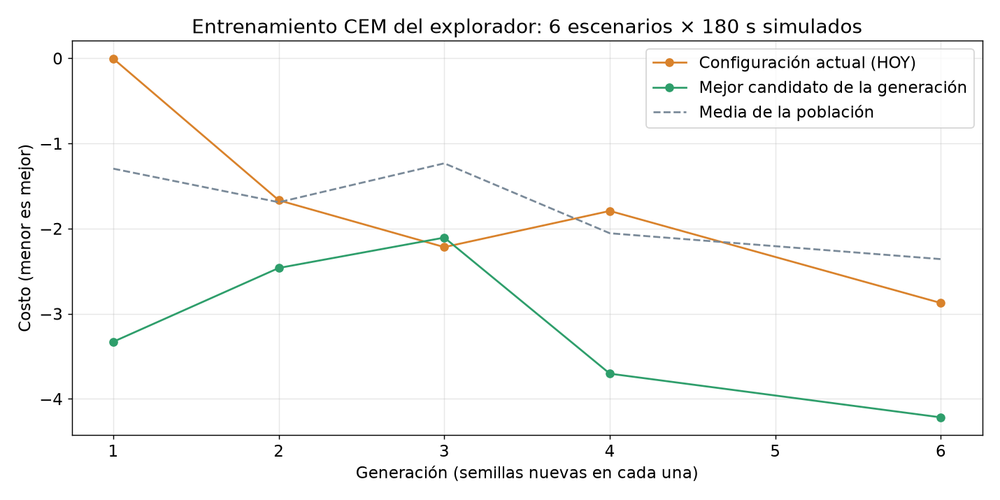
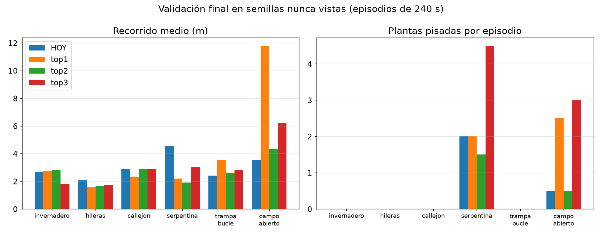
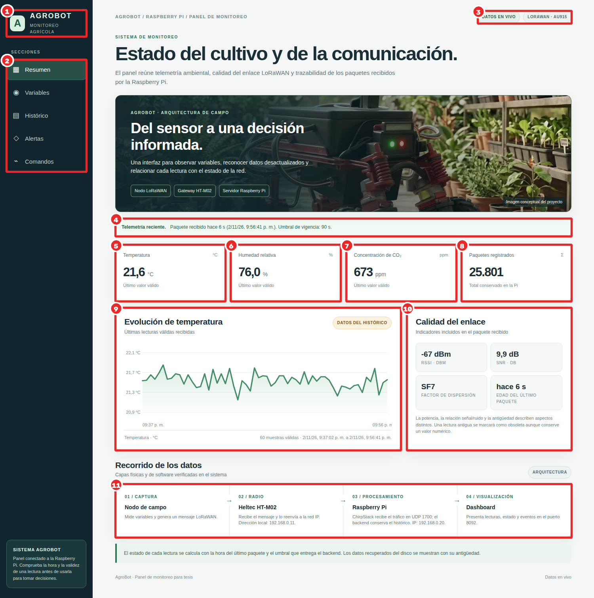
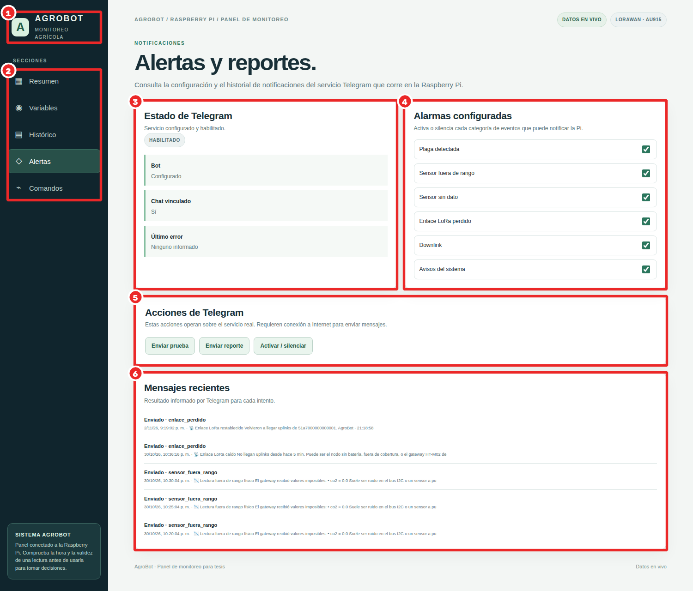

# Complemento a la tesis «Prototipo robótico autónomo de exploración y monitoreo de entornos agrícolas controlados»

Preparado el 2 de noviembre de 2026 sobre el borrador `TESIS_DAVID_GOMEZ_REVISION_REDACCION_20261101.pdf` (252 páginas).
Cada sección indica dónde se inserta. Las referencias nuevas continúan la numeración del borrador (la última es [48]); las cifras salen de los informes y registros del repositorio, citados en cada tabla.

**Convención de verificación.** ✔ = fuente consultada en línea el 2-nov-2026 (catálogo abierto de ISO, Crossref/DOI, sitio oficial). ◐ = referencia conocida que no se pudo abrir desde la Jetson (sitio con bloqueo de bots o sin respuesta): comprobar el texto vigente antes de imprimir.

# Parte A. Nueva sección del Capítulo I

*Insertar como 1.3.15, después de 1.3.14 (Servidor ChirpStack y protocolo MQTT).*

## 1.3.15 Agricultura 5.0: definición y marco normativo

### 1.3.15.1 De la Agricultura 4.0 a la 5.0

La Agricultura 4.0 se caracteriza por la digitalización y la automatización de las labores agrícolas: sensores, conectividad, analítica de datos y máquinas que ejecutan tareas sin intervención humana [49][50]. La Agricultura 5.0 no reemplaza esas tecnologías: cambia el criterio con que se diseñan. Holzinger et al. la describen como la etapa que sustituye a la Agricultura 4.0 cuando la automatización total encuentra límites en el campo, y la basan en una inteligencia artificial centrada en el ser humano: el conocimiento del agricultor permanece dentro del lazo de decisión (*human-in-the-loop*) y la supervisión humana de la IA es un requisito social, ético y legal [49]. El mismo grupo había advertido que la IA aplicada a granjas y bosques debe ser explicable y robusta, porque los modelos estadísticos reaccionan de forma drástica a cambios pequeños de los datos [50].

El término es paralelo a la «Industria 5.0» de la Comisión Europea, que añade a la eficiencia tres valores: centrado en el ser humano, sostenible y resiliente [51]. Martos et al. sitúan la teledetección y las redes inalámbricas de sensores dentro de esta transición, con el objetivo de producir más con menos recursos y contribuir a los Objetivos de Desarrollo Sostenible, en particular al ODS 2 «Hambre cero» [52][53]. La FAO, en *El estado mundial de la agricultura y la alimentación 2022*, dedicado a la automatización, señala que su adopción depende del contexto, y que puede excluir a pequeños productores si no se acompaña de políticas que la hagan accesible [54].

Oliveira et al. revisan el estado del arte de la robótica agrícola y concluyen que los principales retos son la navegación en entornos no estructurados, la percepción robusta frente a cambios de iluminación y vegetación, y la interacción segura con las personas [55].

**Relación con AgroBot.** El prototipo responde a esos criterios de forma concreta:

- **Centrado en el ser humano.** El manejo asistido pausa la autonomía cuando el operador toma el mando y registra la corrección para aprender de ella. Ningún parámetro ni modelo entrenado se instala sin confirmación del operador. Las alertas llegan al celular por Telegram.
- **Sostenible.** El prototipo inspecciona planta por planta para detectar plagas temprano, lo que permite tratamientos localizados en lugar de aplicaciones generales. Esta tesis no mide la reducción de insumos; queda como trabajo futuro.
- **Resiliente.** La telemetría LoRaWAN es independiente del canal de control. El sistema conserva la pose cuando el SLAM salta, se rinde solo ante un atasco físico, y la parada de emergencia tiene varios caminos (WebSocket, HTTP y downlink de respaldo).

### 1.3.15.2 Normas técnicas internacionales aplicables

Ninguna de estas normas es obligatoria para un prototipo académico. Sirven como marco de diseño y como lista de verificación para pasar del prototipo a un equipo de campo. La tabla A1 resume las normas vigentes según el catálogo abierto de ISO (consultado el 2-nov-2026).

**Tabla A1.** Normas técnicas de referencia para un robot agrícola autónomo.

| Norma | Título (resumido) | Estado | Qué exige o aporta | Relación con AgroBot |
|---|---|---|---|---|
| ISO 18497-1:2024 [56] ✔ | Seguridad de máquinas agrícolas parcialmente automatizadas, semiautónomas y autónomas — Parte 1: principios de diseño y vocabulario | Vigente (31-jul-2024); reemplaza a ISO 18497:2018 | Marco de seguridad para máquinas agrícolas con autonomía, con apreciación del riesgo | Base para clasificar al AgroBot como máquina semiautónoma con operador supervisor |
| ISO 18497-2:2024 [56] ✔ | Parte 2: principios de diseño de los sistemas de protección contra obstáculos | Vigente | Detección de obstáculos y reacción segura | LIDAR 2D + cámara; obstáculos bajos invisibles al LIDAR (caja de 25 cm, sección 3.15) |
| ISO 18497-3:2024 [56] ✔ | Parte 3: zonas de operación autónoma | Vigente | Delimitar dónde puede operar la máquina sola | No implementado (no hay geocerca); prueba pendiente P9 |
| ISO 18497-4:2024 [56] ✔ | Parte 4: métodos de verificación y principios de validación | Vigente | Cómo demostrar que la seguridad funciona | Estructura del apartado de pruebas pendientes (Parte D) |
| ISO 25119-1:2018 (+Amd 1:2020) [57] ✔ | Tractores y maquinaria agrícola y forestal — Partes de los sistemas de control relativas a la seguridad — Parte 1 | Vigente (nueva edición en borrador) | Seguridad funcional del control (niveles AgPL) | La parada de emergencia no tiene nivel de prestaciones evaluado |
| ISO 12100:2010 [58] ✔ | Seguridad de las máquinas — Principios generales para el diseño — Evaluación y reducción del riesgo | Vigente (revisión en borrador) | Método general de apreciación del riesgo | Matriz de riesgos del prototipo (tabla A4) |
| ISO 13849-1:2023 [59] ✔ | Partes de los sistemas de mando relativas a la seguridad — Parte 1 | Vigente | Categorías y nivel de prestaciones (PL) | Referencia para una parada de emergencia cableada (pendiente) |
| ISO 11783-1:2017 [60] ✔ | Red de comunicación serie de datos para control (ISOBUS) | Vigente | Interoperabilidad tractor–apero | No aplica al prototipo; se cita como norma del sector |
| ISO/IEC 22989:2022 [61] ✔ | Inteligencia artificial — Conceptos y terminología | Vigente | Vocabulario común de IA | Terminología de modelos y datos |
| ISO/IEC 23894:2023 [62] ✔ | Inteligencia artificial — Guía para la gestión del riesgo | Vigente | Identificar y tratar riesgos de sistemas con IA | Falsos positivos de plaga documentados y mitigados (sección 3.14) |
| ISO/IEC 42001:2023 [63] ✔ | Inteligencia artificial — Sistema de gestión | Vigente | Gobierno del ciclo de vida de la IA | Trazabilidad con git, MANIFEST y despliegue confirmado |
| ISO/IEC 27001:2022 [64] ✔ | Sistemas de gestión de la seguridad de la información | Vigente | Seguridad de la información | Red aislada; dashboards locales sin autenticación (pendiente) |

ISO 13482:2014 (robots de cuidado personal) está siendo reemplazada por una norma general para robots de servicio (ISO/FDIS 13482, en votación final) [65] ✔. Conviene citarla solo como tendencia.

### 1.3.15.3 Marco regulatorio internacional de referencia

- **Reglamento (UE) 2024/1689 de Inteligencia Artificial** [66] ◐. Clasifica los sistemas de IA por nivel de riesgo y exige supervisión humana en los de alto riesgo, entre ellos los componentes de seguridad de máquinas. No rige en Ecuador. Es la referencia que Holzinger et al. señalan como impulsora de la Agricultura 5.0 [49].
- **Reglamento (UE) 2023/1230 relativo a las máquinas** [67] ◐. Sustituye a la Directiva 2006/42/CE y es aplicable desde el 20-ene-2027. Incorpora de forma explícita las máquinas con comportamiento autónomo y la IA como componente de seguridad.
- **Recomendación de la UNESCO sobre la ética de la IA (2021)** [68] ◐ y **Agenda 2030 de Naciones Unidas** (ODS 2, 9 y 12) [53] ✔. Marco ético y de sostenibilidad de alcance mundial.

### 1.3.15.4 Marco legal ecuatoriano

**Tabla A2.** Normas ecuatorianas que tocan al prototipo (◐: verificar el texto vigente en el Registro Oficial).

| Norma | Publicación | Por qué importa para AgroBot |
|---|---|---|
| Constitución de la República del Ecuador [69] ◐ | R.O. 449, 20-oct-2008 | Art. 281: soberanía alimentaria; su numeral 3 encarga fortalecer «la introducción de tecnologías ecológicas y orgánicas en la producción agropecuaria». Arts. 385–388: sistema de ciencia, tecnología e innovación |
| Ley Orgánica de Telecomunicaciones [70] ◐ | R.O. 3er Supl. 439, 18-feb-2015 | El espectro es un recurso estratégico; el uso de bandas de uso libre se rige por la normativa de ARCOTEL |
| Plan Nacional de Frecuencias, v6.0 (ARCOTEL) [71] ✔ | 14-jul-2021 | **902–915 MHz** está identificada para telefonía móvil IMT (nota EQA.40, p. 69). Solo **915–928 MHz** admite, a título secundario, sistemas de Uso Determinado en Bandas Libres, UDBL (nota EQA.45, p. 154; Res. ARCOTEL-2018-0661). Por eso AgroBot usa AU915 (1.3.15.6) |
| Ley Orgánica de Protección de Datos Personales [73] ◐ | R.O. 5º Supl. 459, 26-may-2021 | Las fotos y videos del robot pueden captar personas. El proyecto ya separa `fotos_seguras/` y excluye personas y piel de los datasets publicados |
| Ley Orgánica de Sanidad Agropecuaria [74] ◐ | R.O. Supl. 27, 3-jul-2017 | Agrocalidad es la autoridad de sanidad vegetal. Una alerta de plaga del robot es un aviso de monitoreo, no un diagnóstico oficial |
| Ley Orgánica de Agrobiodiversidad, Semillas y Fomento de la Agricultura Sustentable [75] ◐ | R.O. Supl. 10, 8-jun-2017 | Fomento de la agricultura sustentable y de la investigación aplicada |

### 1.3.15.6 Plan de frecuencias LoRaWAN: AU915

Los planes regionales LoRaWAN de América usan la banda ICM de la Región 2 de la UIT, 902–928 MHz (nota 5.150 del Reglamento de Radiocomunicaciones, incorporada en el PNF [71]). En Ecuador, el Plan Nacional de Frecuencias v6.0 de ARCOTEL [71] identifica 902–915 MHz para las telecomunicaciones móviles internacionales (IMT, nota EQA.40, p. 69). Solo en 915–928 MHz permite, a título secundario, sistemas de Uso Determinado en Bandas Libres, UDBL (nota EQA.45, p. 154; Res. ARCOTEL-2018-0661). Por eso AgroBot usa el plan **AU915-928**, el mismo que la referencia de The Things Network asigna a Ecuador [72].

| Plan | Subida (canales 0–7, 125 kHz) | Bajada (RX1) | Dentro de 915–928 MHz |
|---|---|---|---|
| **AU915, sub-banda 1 (usado por AgroBot; máscara `0x00FF`)** | 915,2–916,6 MHz | 923,3–927,5 MHz | Sí |
| US915, sub-banda 1 (por defecto en Heltec y ChirpStack) | 902,3–903,7 MHz | 923,3–927,5 MHz | No en la subida |

**Configuración.** El plan se fija en tres puntos:

1. En el firmware del nodo, la región `ACTIVE_REGION` = `LORAMAC_REGION_AU915` (menú de la placa en el IDE de Arduino), con la máscara de canales `0x00FF` (canales 0–7).
2. En el gateway HT-M02, *Region* = AU915 con los canales 0–7.
3. En ChirpStack, la región `au915_0` y el perfil del dispositivo en AU915, con activación OTAA.

**Independencia de la arquitectura.** El plan regional es un parámetro de configuración. El radio SX1262 de la Heltec ESP32 LoRa V3 y el gateway HT-M02 de 915 MHz cubren toda la banda 902–928 MHz. El payload de 17 bytes, el decodificador, ChirpStack, MQTT, el servidor de la Raspberry Pi, el panel, Telegram y el canal de control del robot no dependen del plan. AU915 impone en algunos perfiles un tiempo de permanencia (*dwell time*) de 400 ms; con 17 bytes de carga (30 con la cabecera LoRaWAN) a SF7 y 125 kHz el tiempo en el aire es de unos 72 ms, muy por debajo de ese límite.

### 1.3.15.5 Matriz de alineación de AgroBot con la Agricultura 5.0

**Tabla A3.** Requisito, evidencia en el sistema y estado. «Parcial» significa que existe una medida, pero no está verificada con el método que pide la norma.

| Requisito (fuente) | Evidencia en AgroBot | Estado |
|---|---|---|
| Supervisión humana de la IA [49][66] | Manejo asistido: el mando manual pausa la autonomía y registra la corrección. Ningún modelo o parámetro se despliega sin confirmación. Dashboard con STOP | Cumple (prototipo) |
| Parada de emergencia confiable [57][59] | STOP por WebSocket y HTTP a la vez; `_parada_total`; downlink LoRaWAN de respaldo (hasta ~30 s) | Parcial: no hay paro cableado ni nivel de prestaciones evaluado |
| Protección contra obstáculos [56] | LIDAR 360°, anticolisión, freno por cámara, predictor de colisión por pulso | Parcial: el LIDAR no ve obstáculos bajos y la cámara da falsos obstáculos en simulación (3.15.3) |
| Zona de operación autónoma [56] | Mapas con nombre, misiones dentro del mapa | Pendiente: no hay geocerca (P9) |
| Verificación y validación [56] | Simulador con el código real, Monte Carlo, entrenamiento por búsqueda, 437 pruebas automáticas | Parcial: falta la campaña física repetida (Parte D) |
| Gestión del riesgo de la IA [62] | Falsos positivos medidos (fondos sin planta: 87 % → 0,8 % con PLAGASX v8); filtros por especie y por maceta | Parcial: falta recall con etiquetas |
| Trazabilidad [63] | Repositorio git, MANIFEST, informes fechados, modelos respaldados antes de desplegar | Cumple |
| Robustez del dato [50] | Vigía de pose, tiempo monótono ante saltos de reloj, vigencia de 90 s en el panel de la Pi, marca de datos simulados | Cumple (prototipo) |
| Protección de datos personales [73] | Carpeta `fotos_seguras/`, datasets sin personas | Parcial: no hay política escrita ni consentimiento |
| Uso del espectro [70][71] | Plan AU915, canales 0–7 (915,2–916,6 MHz), dentro de la banda de uso libre 915–928 MHz (EQA.45) | Cumple por diseño; verificar las frecuencias en el registro del gateway (P8) |
| Ciberseguridad [64] | Red del robot aislada; solo la Pi sale a internet; token de Telegram por variable de entorno | Parcial: los dashboards no tienen autenticación |
| Sostenibilidad [51][52] | Inspección planta a planta y detección temprana | Pendiente: medir el ahorro de insumos |

**Tabla A4.** Apreciación de riesgos resumida (método ISO 12100 [58]; S = severidad, P = probabilidad, de 1 a 3).

| Peligro | Causa observada | S | P | Medida existente | Medida pendiente |
|---|---|---|---|---|---|
| Vuelco | Bulto de 5 cm volcó el robot (9-oct); centro de gravedad a 0,20 m | 2 | 2 | Detector de vuelco entrenado (apagado por defecto) | Activarlo tras la prueba P5; límites de velocidad en pendiente |
| Pisar plantas | Obstáculos bajos invisibles al LIDAR; robot sin visión trasera | 2 | 3 | Cámara inclinable, prioridad adelante, filtro del sendero | Cámara trasera o parachoques de contacto |
| Golpe a personas | Masa de 12 kg y velocidad baja | 2 | 1 | STOP, anticolisión LIDAR | Paro cableado; zona de operación (P9) |
| Decisión con pose errónea | Salto de reloj de +711 s (27-oct): saltos de pose de 30 m | 2 | 2 | Vigía de pose, tiempo monótono | Reloj RTC con batería |
| Falsa alarma de plaga | Detector fuera de dominio | 1 | 3 | PLAGASX v8, filtros por especie y por maceta | Recall con etiquetas (P6) |
| Pérdida del enlace | Canal del AP distinto al del cliente WiFi | 1 | 2 | Enlace C3 redundante (BLE y WiFi), alarma por enlace perdido | Prueba de alcance (P7) |

# Parte B. Capítulo III — resultados completados y mejorados

*Sustituye el contenido en blanco de 3.12 y 3.13 y agrega las secciones 3.14 a 3.19. El actual «3.14 Presupuesto» pasa a ser 3.20. La numeración de figuras y tablas debe ajustarse en Word.*

## 3.12 Pruebas físicas en entornos interiores

**Tabla 55.** Configuración y condiciones de las pruebas interiores.

| Ensayo | Fecha | Escenario | Configuración | Referencia |
|---|---|---|---|---|
| I-1 SLAM con regreso a la marca | 22-oct-2026 | Sala, 23 m con muchos giros, 3 min, manejado con el mando | slam_toolbox con filtro de caja del chasis | Grabación `20261022_213805_5dde93`; `simular_slam.py` |
| I-2 Demostración de plantas en maceta | 23-oct-2026 | Laboratorio con mesas, sillas y una coliflor en maceta | Misión de plantas en maceta; detector de macetas | `mision_plantas.py`; `simular_demo.py` |
| I-3 Escenario en L | 28-oct-2026 | Pasillo de 0,70 m (primer metro) y 0,90 m; 4 plantas reales (1 coliflor) | Misión ×4, giro de lazo cerrado | `~/.agrobot/pruebas/L_20261028/RESUMEN.md` |
| I-4 Escenario en L, segunda sesión | 28-oct-2026 | Igual que I-3, con armarios y puertas | Revisión de avisos de plaga | Commit 4c591f0 |

**Tabla 56.** Resultados de navegación interior.

| Ensayo | Distancia | Tiempo | Error | Contactos |
|---|---|---|---|---|
| I-1 | 23 m | 3 min | Cierre de bucle 36 cm y −67° en vivo (≈1,5 % del recorrido); reproducido en simulación: 23–24 cm | No registrados |
| I-3 | Pasillo en L completo, 4 pasadas | — | Giros de lazo cerrado de 15–22° sí giran; pulsos de 6° de la exploración dan ≈1°; el giro de 360° se cortó a 158° por falta de espacio (exige 0,25 m delante y detrás en un pasillo de 0,90 m) | No registrados (sin sensor de contacto) |

**Tabla 57.** Resultados de percepción interior.

| Ensayo | Modelo | Métrica | Resultado |
|---|---|---|---|
| I-2 | Detector de macetas (Kaggle) | Cuadros de la cámara del robot | 20/20 con maceta detectada; 0/30 sin maceta con falsa detección |
| I-3 | CLIP sobre el recorte de la planta | Identificación de la coliflor | 17/17 (p_col 0,93–0,996, frente a ≤ 0,37 en las otras plantas) |
| I-3 | Misión de escaneo | Plantas escaneadas por pasada | 6 en la pasada 1 (duplicados); 4/4 exactas en las pasadas 3 y 4 |
| I-4 | PLAGASX | Avisos de plaga revisados | 16–17 de 18 eran puertas, cajas o pared sin maceta en el cuadro. Corrección: sin maceta, el aviso se descarta |

### 3.12.1 Análisis de las pruebas interiores

El SLAM interior cierra el bucle con un error de posición del 1 al 1,5 % del recorrido. Es suficiente para volver a una planta en una sala, no para medir distancias finas. El ajuste fino de slam_toolbox para salas empeoró el resultado y no se aplicó.

La cadena de percepción mejora cuando se combinan modelos: el detector de macetas localiza la planta y CLIP confirma la especie en el recorte. Esa combinación separó la coliflor de las otras plantas en 17 de 17 vistas. En cambio, PLAGASX por sí solo produjo avisos sobre puertas y armarios; por eso se exige el contexto.

El punto débil es el giro: los pulsos cortos pedidos por la exploración (6°) rinden alrededor de 1°, mientras que el giro de lazo cerrado con tramos de 20° sí alcanza el ángulo. Esto motivó el giro hasta un rumbo de la sección 3.15.

### 3.12.2 Conclusiones de la campaña interior

El robot localiza, reconoce la planta objetivo y la inspecciona en interiores con una precisión útil. No hay medida de contactos (falta un sensor de contacto) y el giro por pulsos cortos es insuficiente. Ambas cosas quedan en las pruebas P1 y P3 de la Parte D.

## 3.13 Pruebas físicas en entornos exteriores

**Tabla 58.** Configuración y condiciones de las pruebas exteriores.

| Ensayo | Fecha | Terreno | Iluminación | Configuración |
|---|---|---|---|---|
| E-1 | 27-oct-2026 | Patio con macetas (suculentas) y tramo cubierto | Diurna | Misión de plantas; giro de lazo cerrado; pulsos de 6° |
| E-2 | 28-oct-2026 | Huerta con coles sembradas, sendero corto | Diurna | Exploración; perfil exterior; cámara a 98° |
| E-3 | 29-oct-2026 | Huerta: sendero de tierra removida con coles, maíz y arbustos | Diurna | Perfil exterior, PLAGASX v8, filtros del sendero, `GIRO_IZQ_FACTOR` = 2,3 |

**Tabla 59.** Resultados de navegación exterior.

| Ensayo | Distancia | Tiempo | Error / respuesta | Contactos |
|---|---|---|---|---|
| E-1 | 41,9 m (pose SLAM sin los 3 saltos) | Misión de 664 s | Salto de reloj de +711,5 s → saltos de pose de 30,1 y 24,4 m; giro mediano de 1,5° (giroscopio) frente a 6° pedidos | 3 activaciones de anticolisión; sin sensor de contacto |
| E-2 | 24,8 m adelante y 8,8 m atrás en autonomía | Sesión de 54 min; **16,2 min (30 %) en autonomía**, en 45 tramos | 26 % de lo recorrido en autonomía fue hacia atrás; el robot pisó plantas al retroceder sin visión trasera | No medidos |
| E-3 | ~3 m en x y 4,5 m en y | 781 s de video; 77 % de las muestras parado | 1525° de giro acumulado. Los pulsos largos (2–4,6 s) giran 0–5° en tierra suelta; los cortos (0,4–1 s), 13–23° | Sin colisiones registradas; seguridad siempre «normal» |

**Tabla 60.** Resultados de percepción y comunicaciones exteriores.

| Ensayo | Modelo | Métrica | Resultado |
|---|---|---|---|
| E-1 | PLAGASX (anterior) | Avisos sobre plantas que no son col | 22 avisos, todos fuera de dominio (suculentas) |
| E-2 | PLAGASX (anterior) | Avisos de plaga sin plaga | 261 avisos; 360 falsas «macetas»; detector de coles en 1 de 30 cuadros con la cámara a 98° |
| E-2 | Clasificador de entorno | Validación por bloques | 97,8 % (reglas: 91,6 %); «interior tomado por exterior» 2,4 % |
| E-3 | PLAGASX v8 | Falsas plagas en campo | 0 en 14 min (73 detecciones únicas, todas de col o maceta) |
| Todas | Telemetría LoRaWAN | Enlace | Ver sección 3.17. El CO₂, la temperatura y la humedad del 23-oct en adelante son simulados (SCD40 dañado) |

### 3.13.1 Análisis de las pruebas exteriores

La comparación entre E-1, E-2 y E-3 muestra una mejora medible en percepción. Los avisos falsos de plaga pasaron de cientos por sesión a cero en E-3, gracias a tres medidas: el modelo PLAGASX v8, el filtro por especie con CLIP y la supresión de avisos sin planta en el cuadro. En los fondos sin planta del conjunto de prueba, el detector anterior disparaba en el 87 % de las imágenes y v8 en el 0,8 % (tabla 3.14-1).

La navegación exterior sigue siendo el límite:

1. **El giro en tierra suelta.** Los pulsos largos patinan; los cortos sí giran. No hay evidencia de que un lado sea más débil: 2,7 °/s a la izquierda frente a −2,8 °/s a la derecha por segundo ordenado.
2. **Los márgenes del perfil exterior son más exigentes que el sendero.** El perfil pide 100 cm libres delante y 60 cm a los lados. El operador tuvo que empujar hacia adelante 95 veces con 89 cm libres delante (mediana) y 38–39 cm a cada lado. La sección 3.16 muestra en simulación que bajar ese margen sí aumenta el recorrido, pero a costa de pisar más plantas, y que el límite real está en la percepción.
3. **La integridad del tiempo.** La Jetson no tiene RTC, y los saltos del reloj de pared corrompieron la pose en E-1. Desde entonces se usa el tiempo monótono y el vigía de pose.

### 3.13.2 Conclusiones de la campaña exterior

El sistema ejecuta exploración, inspección y registro en una huerta real, con un 30 % del tiempo en autonomía (E-2) y sin falsas alarmas de plaga (E-3). No demuestra todavía navegación autónoma completa en el sendero, ni precisión del mapa con referencia externa, ni ausencia de contactos. Estas son las pruebas P1, P2 y P4 de la Parte D.

## 3.14 Percepción: comparación de modelos de plagas

**Tabla 3.14-1.** Detector de plagas anterior frente a PLAGASX v8 (conf 0,30, imgsz 480; `~/.agrobot/aprendizaje/plagasx_v8/comparacion_*.json`).

| Conjunto | Anterior | PLAGASX v8 |
|---|---|---|
| Fondos sin planta (250 negativos), con alguna caja | 217/250 (87 %) | 2/250 (0,8 %) |
| Negativos de interior «negint» (86) | 78/86 (91 %) | 1/86 (1 %) |
| Cuadros de exterior sin plaga con alguna caja | 14 | 2 |
| Positivos de exterior | 100/100 | 99/100 |
| Positivos «ip» | 104/124 | 123/124 |
| Positivos propios «mio» | 13/17 | 17/17 |
| Positivos «caj» (sin etiquetas revisadas) | 196/268 | 130/268 |

Fuente: `~/.agrobot/aprendizaje/plagasx_v8/comparacion_det.json` y `comparacion_test.json`. En sesiones nunca vistas (exterior 27-oct, interior 23–26 y L del 28-oct), los cuadros con alguna caja pasaron del 50–67 % al 2–5 %.

La caída de falsos positivos es grande y consistente. Falta medir el recall con etiquetas en el conjunto «caj», donde las detecciones bajan de 196 a 130 de 268 sin que se sepa todavía si son pérdidas reales; por eso v8 se considera validado en especificidad, no en sensibilidad (prueba P6).

## 3.15 Autonomía robusta y detector de vuelco (2-nov-2026)

Se implementaron cuatro mejoras de software, cada una con su interruptor y con pruebas automáticas. Detalle en `docs/AUTONOMIA_ROBUSTA_20261102.md`.

1. **Vigía de la pose.** Si el ancla del SLAM salta más de 0,5 m o 25°, conserva el ancla anterior y navega con odometría. Si se pierde, la autonomía espera quieta en lugar de decidir con una pose falsa. Responde directamente al incidente de E-1.
2. **Giro hasta un rumbo.** Apunta al centro del hueco libre y gira en tramos de lazo cerrado hasta alcanzarlo, midiendo el resultado. En el simulador visual se observó «girado −57,8° de −56° pedidos, error 1,8°, alcanzado en 2 tramos». Además, para si la pose y el giroscopio discrepan más de 25°.
3. **Atasco por pulso con salida escalonada.** Cuatro niveles de maniobra. Solo se rinde ante un atasco físico, y reintenta a los 90 s.
4. **Detector de vuelco entrenado.** Ver la tabla 3.15-1.

**Tabla 3.15-1.** Detector de vuelco: regla actual frente al detector entrenado (datos no vistos; `docs/VUELCO_DETECTOR_20261102/INFORME.md`).

| | Vuelcos simulados detectados (≤ 3 s) | Falsas alarmas en 0,7 h de marcha real |
|---|---|---|
| Regla instantánea del modo seguro | 51/128 (40 %) | 92,7 por hora |
| Detector entrenado | 110/128 (86 %); 124/128 antes de 6 s | 0 |

El hallazgo clave es que el IMU real, en marcha, registra inclinaciones aparentes de 50–120° por los golpes de cada pulso, y el nodo se congela 2–5 s repitiendo un paquete. Una regla instantánea es inutilizable con esos datos, y por eso el modo seguro se enclavaba. Los vuelcos son simulados (péndulo sobre la arista más ruido real del IMU): el detector queda apagado hasta la prueba P5.

### 3.15.1 Fidelidad del simulador

Al comparar el simulador del explorador con el backend se encontraron cinco diferencias que hacían optimistas o inválidos los resultados previos:

1. El explorador se colgaba en el primer pulso de rumbo por un argumento que el simulador no aceptaba.
2. No recibía el scan del LIDAR, con lo que el hueco, el predictor y el sonar quedaban apagados.
3. Giraba a tiempo fijo, mientras el robot gira por giroscopio.
4. Fusionaba la cámara aunque estuviera desactivada.
5. Detectaba el suelo con el método de histograma, mientras el robot usa el de apariencia.

Las cinco se corrigieron en `simulador_pasivo/correr.py` y en el simulador visual (`simulador/correr.py`). Lección metodológica: un simulador solo valida si ejecuta exactamente los mismos callbacks que el robot. Por eso los resultados del explorador anteriores al 2-nov se consideran preliminares.

## 3.16 Entrenamiento intensivo de 7 horas (2–3 nov 2026)

**Motivo.** Con el simulador corregido, la cámara reporta obstáculo a una mediana de 0,42 m del centro del robot, es decir, unos 18 cm libres por delante. El perfil exige 100 cm (`avance_libre_cm`), así que el explorador casi no avanza. En la huerta (E-3) el operador empujó hacia adelante con 89 cm libres: es el mismo patrón observado en el campo.

**Método.** Se usó el método de entropía cruzada (CEM), una búsqueda evolutiva, sobre 12 parámetros a la vez:

- cuánto confiar en la cámara: obstáculos por cámara y cámara como LIDAR, ambos activables; umbral y textura del suelo por apariencia;
- los márgenes del explorador: avance, lado y retroceso libres, histéresis, pausa, grados por pulso y margen del predictor;
- la espera antes de reintentar un atasco.

Cada candidato se evalúa en 6 escenarios (invernadero, hileras, callejón, serpentina, trampa en bucle y campo abierto) de 180 s simulados, con una semilla nueva por generación. La configuración actual del robot («HOY») se evalúa en las mismas semillas.

El costo premia el recorrido y las celdas nuevas, y castiga las plantas pisadas (×4), las colisiones (×3) y el tiempo en contacto. Al final, los tres mejores se validan contra HOY en semillas nunca vistas, con episodios de 240 s. Código: `simulador_pasivo/entrenar_explorador_7h.py`; resultados en `~/.agrobot/aprendizaje/explorador_7h_*/`.

**Desarrollo.** El entrenamiento corrió del 2-nov 21:59 al 3-nov 04:59 (UTC), con 3 procesos y una población de 10 candidatos más HOY. Un corte de energía apagó la Jetson hacia las 00:30, tras la generación 3. El entrenamiento se reanudó desde el historial guardado a las 02:29, conservando los mejores candidatos.

En la generación 5 fallaron los 66 episodios al arrancar, con el aviso «sin datos del LIDAR». Fallaron también los de HOY, así que no se debe a un candidato. El entrenador descarta automáticamente una generación en la que falla más de la mitad de los episodios, de modo que esa generación no alteró la búsqueda. Quedaron 5 generaciones válidas (1–4 y 6).

**Resultados de la búsqueda.** El mejor candidato de cada generación superó a HOY en las generaciones 1, 2, 4 y 6. En la 6 obtuvo −4,22 frente a −2,88 de HOY. Los mejores candidatos coinciden en tres cosas:

- mantienen la cámara activa (obstáculos y «cámara como LIDAR»), es decir, la búsqueda no gana recorrido apagando la percepción;
- reducen el avance libre exigido de 100 cm a 50–63 cm;
- suben el umbral de suelo por apariencia de 2,6 a 4,4–4,8.

**Validación final.** Los 3 mejores candidatos y HOY se evaluaron en 2 semillas nunca vistas, en los 6 escenarios, con episodios de 240 s. Los valores por escenario son la media de las 2 semillas.

Tabla 3.16-1. Validación final (2 semillas × 6 escenarios × 240 s; menor costo es mejor).

| Configuración | Avance libre (cm) | Umbral suelo | Costo | Recorrido total (m) | Plantas pisadas (suma) | Colisiones (suma) |
|---|---|---|---|---|---|---|
| **HOY** (actual) | 100 | 2,6 | **−2,20** | 18,2 | 2,5 | 0 |
| top1 (gen. 6) | 50 | 4,8 | −1,97 | 24,3 | 4,5 | 0,5 |
| top2 (gen. 4) | 61 | 4,4 | −2,09 | 16,2 | 2,0 | 0 |
| top3 | 63 | 4,7 | +1,00 | 18,5 | 7,5 | 0 |

Tabla 3.16-2. Recorrido medio (m) / plantas pisadas por escenario.

| Escenario | HOY | top1 | top2 | top3 |
|---|---|---|---|---|
| Invernadero | 2,67 / 0 | 2,75 / 0 | 2,83 / 0 | 1,79 / 0 |
| Hileras | 2,09 / 0 | 1,60 / 0 | 1,64 / 0 | 1,74 / 0 |
| Callejón | 2,92 / 0 | 2,35 / 0 | 2,88 / 0 | 2,92 / 0 |
| Serpentina | 4,54 / 2 | 2,20 / 2 | 1,92 / 1,5 | 3,01 / 4,5 |
| Trampa en bucle | 2,41 / 0 | 3,55 / 0 | 2,63 / 0 | 2,83 / 0 |
| Campo abierto | 3,56 / 0,5 | 11,80 / 2,5 | 4,31 / 0,5 | 6,22 / 3 |

**Interpretación.**

1. **Ningún candidato supera a HOY en la validación.** Los candidatos que ganaron en entrenamiento quedaron por detrás en semillas nuevas (−1,97 y −2,09 frente a −2,20). Su ventaja venía en parte de las semillas concretas de cada generación, es decir, de sobreajuste. Por eso **la configuración del robot no se cambia**: es el resultado que la validación separada estaba diseñada para detectar.
2. **Reducir el margen de avance compra recorrido a costa de seguridad.** top1 recorre 3,3 veces más en campo abierto (11,8 m frente a 3,6 m), pero pisa 5 veces más plantas allí y es el único con colisión. En un cultivo, pisar plantas pesa más que recorrer más.
3. **El problema de fondo no es un parámetro.** Todas las configuraciones recorren solo 1,6–4,5 m en 4 minutos en los escenarios cerrados. Esto confirma que el cuello de botella es la percepción: la cámara reporta obstáculo a unos 18 cm por delante del robot. Mejorarlo exige un modelo de transitabilidad mejor o calibrar la cámara del simulador con el robot real (prueba P2), no afinar márgenes.
4. **Lección metodológica para la defensa:** el costo de entrenamiento y el de validación miden cosas distintas. Un resultado de búsqueda solo se adopta si gana en semillas que no participaron en ella.

Datos: `figuras/informe_explorador_7h.json` (copia de `~/.agrobot/aprendizaje/explorador_7h_20261102_2159/informe.json`).

**Límites.** El modelo de cámara del simulador no está medido contra el robot real, y la validación usa solo 2 semillas por escenario: diferencias de costo menores que ~0,3 no son concluyentes. Por eso, antes de cualquier cambio de configuración, se pide la prueba P2.

## 3.17 Dashboard de la Raspberry Pi y alertas por Telegram

El servidor de la Pi (`rpi/server/gateway_server.py`) se suscribe por MQTT a los eventos que ChirpStack publica para cada uplink. Decodifica el payload de 17 bytes del firmware v3 (aceleraciones y giros del MPU6050, CO₂, temperatura y humedad del SCD40), lo valida por rango físico y lo guarda en SQLite. Lo envía al panel por WebSocket y lo expone por REST para el histórico, el CSV y los downlinks.

El panel tiene cinco secciones: Resumen, Variables, Histórico, Alertas y Comandos. Cada parte se explica con capturas anotadas en `docs/INFORME_DASHBOARD_PI/INFORME.md`, igual que el dashboard de la Jetson.

Hay tres decisiones de diseño que conviene defender:

- **Vigencia del dato.** Si el último paquete tiene más de 90 s, el panel lo marca como obsoleto: se muestra como histórico, no como lectura en vivo.
- **Separación de canales.** LoRaWAN lleva telemetría de bajo caudal. El control del robot va por un enlace directo (WiFi, USB o BLE al ESP32-C3). El downlink de emergencia es solo un respaldo, porque un nodo de clase A recibe hasta ~30 s después.
- **Telegram desde la Pi.** La Pi es la única pieza con salida a internet. La Jetson le envía las alertas por la LAN (`POST /api/alert`) y la Pi las publica con la API de bots de Telegram. Para leer comandos usa *long polling*, que no necesita IP pública. Hay seis tipos de alarma (plaga, sensor fuera de rango, sensor caído, enlace perdido, downlink y sistema), cada uno con su interruptor y con un máximo de un aviso cada 5 min.

**Datos de demostración.** Como el SCD40 está dañado, para la defensa se inyectan uplinks simulados por el mismo camino real, MQTT → servidor → panel (`tools/simular_uplinks_pi.py`). Usan un DevEUI propio (`51a7000000000001`), así que nunca se mezclan con datos reales y se pueden borrar. Toda figura o video que los muestre debe indicar «datos simulados».

## 3.18 Discusión frente a la Agricultura 5.0

Los resultados ubican a AgroBot como un prototipo de Agricultura 5.0 en cuanto a diseño, no en cuanto a certificación:

- **Centrado en el ser humano.** Mantiene al agricultor en el lazo: corrige, aprueba despliegues y recibe alertas [49].
- **Errores medidos y publicados.** Los falsos positivos de plaga, los giros que no giran y los saltos de pose están medidos y documentados, y cada corrección tiene evidencia antes y después. Es lo que pide la gestión de riesgos de IA [62].
- **Lo que falta para una máquina de campo** son las verificaciones de ISO 18497-2/3/4 [56] y de seguridad funcional [57][59]: paro cableado, geocerca, sensor de contacto y una campaña repetida con referencia externa. La Parte D las convierte en pruebas concretas.

# Parte C. Inconsistencias detectadas en el borrador

| Id | Dónde | Problema | Sugerencia |
|---|---|---|---|
| I-1 | 1.3.13, 3.5.6.1 y figura 43 | El borrador dice «US915, canales 0–7» y la figura 43 muestra *Region: US915*. Según el PNF v6.0 de ARCOTEL, la subida de US915 (902,3–903,7 MHz) cae en banda IMT; el uso libre está en 915–928 MHz (EQA.40, EQA.45) [71] | Cambiar el texto a «AU915, canales 0–7 (915,2–916,6 MHz)», citar [71] y reemplazar la captura de la figura 43 por la del gateway en AU915 |
| I-2 | 3.5.6.1 | Las viñetas dan el servidor ChirpStack en 192.168.1.100, cuando el texto anterior lo descarta y la red usa 192.168.0.10 | Cambiar a 192.168.0.10 (o «IP de la Raspberry Pi en la LAN») |
| I-3 | 3.5.6.1 | «Potencia máxima de transmisión: 26 dBm, conforme al Plan Nacional (ARCOTEL)» sin cita a la norma ni al artículo | Citar el documento de ARCOTEL o retirar la afirmación (el propio borrador en 3.5.5 advierte no presentar una potencia como autorizada sin la norma) |
| I-4 | Panel de la Pi | El panel en vivo dice que el backend está en 192.168.0.20 (la IP del WiFi de la Pi); la del cable es 192.168.0.10 | Unificar en el texto: cable 192.168.0.10, WiFi 192.168.0.20 |
| I-5 | 3.6.4 | El dashboard de la Pi del repositorio (`rpi/dashboard/index.html`) es una versión anterior a la desplegada | La desplegada se archivó en `rpi/dashboard/vivo_20261102/`; citar esa |
| I-6 | 3.12, 3.13 | Tablas 55–60 en blanco | Completadas en la Parte B |
| I-7 | Datos ambientales | Desde el 23-oct el CO₂, la temperatura y la humedad son simulados (SCD40 dañado) | Declararlo en toda figura que los use |
| I-8 | 3.5.6.2 | Se publica «la clave de ingreso por defecto es admin y el usuario igual admin» | Retirar: la tesis dice no publicar credenciales; recomendar cambiarlas |

# Parte D. Pruebas pendientes (nueva sección 3.19)

*Insertar como 3.19 «Pruebas pendientes y protocolo de validación». Cada prueba tiene objetivo, procedimiento, métrica y criterio de aceptación definidos de antemano, como pide ISO 18497-4 [56]. Las celdas de resultado quedan en blanco hasta ejecutarla.*

| Id | Objetivo | Procedimiento | Métrica | Criterio de aceptación | Resultado |
|---|---|---|---|---|---|
| P1 | Navegación autónoma en el sendero | 5 recorridos del sendero de la huerta, de inicio a fin, sin mando manual; cinta métrica y marcas de inicio y fin | Distancia sin intervención, intervenciones por 10 m, tiempo | ≥ 3 de 5 completos; ≤ 1 intervención por 10 m | |
| P2 | Calibrar la cámara del simulador y contrastar el resultado del entrenamiento de 7 h | (a) Obstáculos a 20, 40, 60 y 90 cm frente al robot: distancia que reporta la cámara real frente a la simulada. (b) A/B en el mismo sendero: config HOY frente a top2 (avance 61 cm), 3 recorridos cada una, orden alternado | Error de distancia de la cámara; recorrido, intervenciones, plantas tocadas (revisión del video) | (a) Error ≤ 10 cm; (b) top2 solo se adopta si mejora el recorrido sin aumentar las plantas tocadas (la simulación predice que no lo hará) | |
| P3 | Giro hasta un rumbo | 20 giros pedidos de 30°, 60° y 90° en baldosa y en tierra; transportador o marcas en el suelo | Error final (°), tramos, tiempo | Error mediano ≤ 6°; ≥ 90 % alcanzados | |
| P4 | Precisión del SLAM con referencia externa | 3 recorridos cerrados de 20–30 m que vuelven a una marca; medir la posición final con cinta | Error de cierre (cm y % del recorrido) | ≤ 2 % del recorrido | |
| P5 | Detector de vuelco | Inclinar el robot de forma controlada (sin motores) a 20°, 35°, 50° y 90° en ambos ejes; 30 min de marcha normal | Detección y latencia; falsas alarmas por hora | 90° detectado en ≤ 2 s; 0 falsas en 30 min | |
| P6 | Recall de PLAGASX v8 | Etiquetar 150 fotos del robot (coles sanas y con plaga) sin ver la salida del modelo | Precisión, exhaustividad y F1 por clase | Exhaustividad de plaga ≥ 0,7 sin perder especificidad (≤ 5 % de falsas) | |
| P7 | Alcance y pérdidas LoRaWAN | Nodo a 50, 100, 200 y 400 m del gateway; 30 paquetes por punto | RSSI, SNR y porcentaje de paquetes recibidos | ≥ 95 % de paquetes a la distancia de trabajo | |
| P8 | Verificación del plan AU915 | Con el nodo, el gateway y ChirpStack en AU915: join OTAA y 100 uplinks; revisar el *Packet Logger* del gateway | Joins correctos; paquetes recibidos; frecuencias registradas | 100 % de joins; ≥ 95 % de paquetes; todas las subidas entre 915,2 y 916,6 MHz | |
| P9 | Zona de operación | Definir una geocerca en el mapa y ordenar misiones que la crucen | Paradas en el borde | 10/10 se detienen antes del borde | |
| P10 | Parada de emergencia | 20 pulsaciones de STOP en marcha (dashboard WiFi) y 5 por downlink | Tiempo hasta velocidad cero (video a 60 fps) | WiFi ≤ 0,5 s; downlink ≤ 40 s | |
| P11 | Obstáculos bajos | Cajas de 10, 16 y 25 cm en el camino, 10 aproximaciones cada una | Paradas antes del contacto | ≥ 9/10 sin contacto | |
| P12 | Sensores ambientales | Reemplazar el SCD40 y comparar con un termohigrómetro de referencia durante 2 h | Error medio de T y HR | T ± 1 °C; HR ± 5 % | |

# Parte E. Referencias nuevas (formato IEEE)

[49] A. Holzinger, I. Fister, I. Fister Jr., H.-P. Kaul y S. Asseng, «Human-Centered AI in Smart Farming: Toward Agriculture 5.0», *IEEE Access*, vol. 12, pp. 62199–62214, 2024, doi: 10.1109/ACCESS.2024.3395532. ✔

[50] A. Holzinger *et al.*, «Digital Transformation in Smart Farm and Forest Operations Needs Human-Centered AI: Challenges and Future Directions», *Sensors*, vol. 22, no. 8, art. 3043, 2022, doi: 10.3390/s22083043. ✔

[51] European Commission, Directorate-General for Research and Innovation, *Industry 5.0: Towards a sustainable, human-centric and resilient European industry*. Luxembourg: Publications Office of the EU, 2021, doi: 10.2777/308407. ✔

[52] V. Martos, A. Ahmad, P. Cartujo y J. Ordoñez, «Ensuring Agricultural Sustainability through Remote Sensing in the Era of Agriculture 5.0», *Applied Sciences*, vol. 11, no. 13, art. 5911, 2021, doi: 10.3390/app11135911. ✔

[53] Naciones Unidas, Departamento de Asuntos Económicos y Sociales, «Goal 2: Zero Hunger», Sustainable Development Goals. [En línea]. Disponible: https://sdgs.un.org/goals/goal2 (consulta: 2-nov-2026). ✔

[54] FAO, *The State of Food and Agriculture 2022. Leveraging automation in agriculture for transforming agrifood systems*. Roma: FAO, 2022, doi: 10.4060/cb9479en. ✔

[55] L. F. P. Oliveira, A. P. Moreira y M. F. Silva, «Advances in Agriculture Robotics: A State-of-the-Art Review and Challenges Ahead», *Robotics*, vol. 10, no. 2, art. 52, 2021, doi: 10.3390/robotics10020052. ✔

[56] ISO, *ISO 18497-1/-2/-3/-4:2024 Agricultural machinery and tractors — Safety of partially automated, semi-autonomous and autonomous machinery* (Parte 1: principios de diseño y vocabulario; Parte 2: sistemas de protección contra obstáculos; Parte 3: zonas de operación autónoma; Parte 4: verificación y validación). Ginebra: ISO, 2024. ✔

[57] ISO, *ISO 25119-1:2018 Tractors and machinery for agriculture and forestry — Safety-related parts of control systems — Part 1: General principles for design and development* (y Amd 1:2020). Ginebra: ISO. ✔

[58] ISO, *ISO 12100:2010 Safety of machinery — General principles for design — Risk assessment and risk reduction*. Ginebra: ISO, 2010. ✔

[59] ISO, *ISO 13849-1:2023 Safety of machinery — Safety-related parts of control systems — Part 1: General principles for design*. Ginebra: ISO, 2023. ✔

[60] ISO, *ISO 11783-1:2017 Tractors and machinery for agriculture and forestry — Serial control and communications data network — Part 1*. Ginebra: ISO, 2017. ✔

[61] ISO/IEC, *ISO/IEC 22989:2022 Information technology — Artificial intelligence — Artificial intelligence concepts and terminology*. Ginebra, 2022. ✔

[62] ISO/IEC, *ISO/IEC 23894:2023 Information technology — Artificial intelligence — Guidance on risk management*. Ginebra, 2023. ✔

[63] ISO/IEC, *ISO/IEC 42001:2023 Information technology — Artificial intelligence — Management system*. Ginebra, 2023. ✔

[64] ISO/IEC, *ISO/IEC 27001:2022 Information security, cybersecurity and privacy protection — Information security management systems — Requirements*. Ginebra, 2022. ✔

[65] ISO, *ISO/FDIS 13482 Robotics — Safety requirements for service robots* (en elaboración; reemplazará a ISO 13482:2014). ✔

[66] Parlamento Europeo y Consejo, Reglamento (UE) 2024/1689, de 13 de junio de 2024, por el que se establecen normas armonizadas en materia de inteligencia artificial, *DO L*, 12-jul-2024. ELI: http://data.europa.eu/eli/reg/2024/1689/oj. ◐

[67] Parlamento Europeo y Consejo, Reglamento (UE) 2023/1230, de 14 de junio de 2023, relativo a las máquinas, *DO L 165*, 29-jun-2023. ELI: http://data.europa.eu/eli/reg/2023/1230/oj. ◐

[68] UNESCO, *Recomendación sobre la ética de la inteligencia artificial*. París: UNESCO, 2021. ◐

[69] Asamblea Constituyente, *Constitución de la República del Ecuador*, Registro Oficial 449, 20-oct-2008. ◐

[70] Asamblea Nacional del Ecuador, *Ley Orgánica de Telecomunicaciones*, Registro Oficial Tercer Suplemento 439, 18-feb-2015. ◐

[71] ARCOTEL, *Plan Nacional de Frecuencias*, versión 6.0, Quito, 14-jul-2021, tabla de atribuciones p. 69 y notas EQA.40 y EQA.45 p. 154. [En línea]. Disponible: https://www.arcotel.gob.ec/wp-content/uploads/2021/10/PNF-V.6.0_14-07-21_v.1.pdf (consulta: 2-nov-2026). ✔

[72] The Things Network, «Frequency Plans by Country». [En línea]. Disponible: https://www.thethingsnetwork.org/docs/lorawan/frequencies-by-country/ (consulta: 2-nov-2026). ✔

[73] Asamblea Nacional del Ecuador, *Ley Orgánica de Protección de Datos Personales*, Registro Oficial Quinto Suplemento 459, 26-may-2021. ◐

[74] Asamblea Nacional del Ecuador, *Ley Orgánica de Sanidad Agropecuaria*, Registro Oficial Suplemento 27, 3-jul-2017. ◐

[75] Asamblea Nacional del Ecuador, *Ley Orgánica de Agrobiodiversidad, Semillas y Fomento de la Agricultura Sustentable*, Registro Oficial Suplemento 10, 8-jun-2017. ◐

[76] J. Petäjäjärvi, K. Mikhaylov, A. Roivainen, T. Hänninen y M. Pettissalo, «On the coverage of LPWANs: range evaluation and channel attenuation model for LoRa technology», en *Proc. 14th Int. Conf. ITS Telecommunications (ITST)*, 2015, pp. 55–59, doi: 10.1109/ITST.2015.7377400. ✔ (base para el protocolo P7)

[77] C. Lee, S. Schätzle, S. A. Lang y T. Oksanen, «Design considerations of a perception system in functional safety operated and highly automated mobile machines», *Smart Agricultural Technology*, vol. 6, art. 100346, 2023, doi: 10.1016/j.atech.2023.100346. ✔ (percepción y seguridad funcional en máquinas agrícolas autónomas; respalda la discusión de 3.18)
